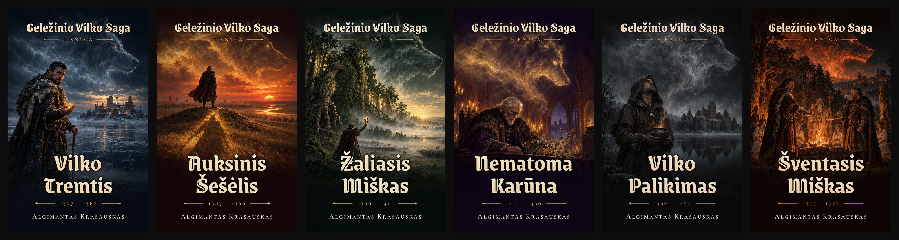
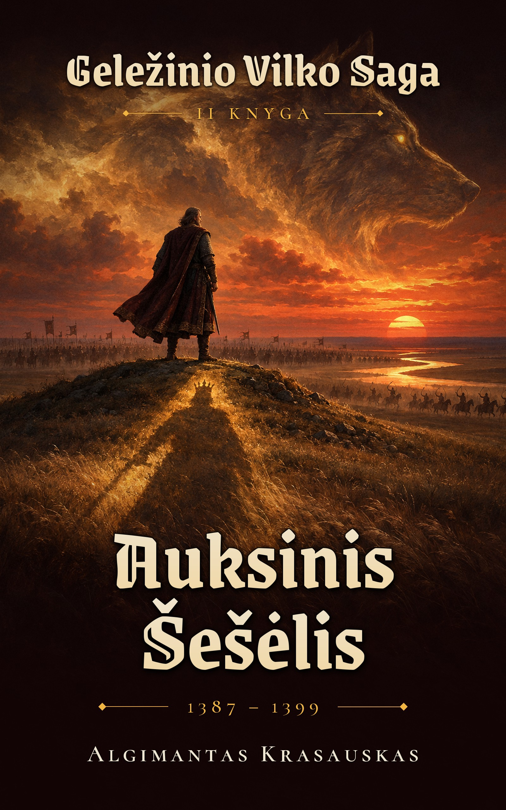
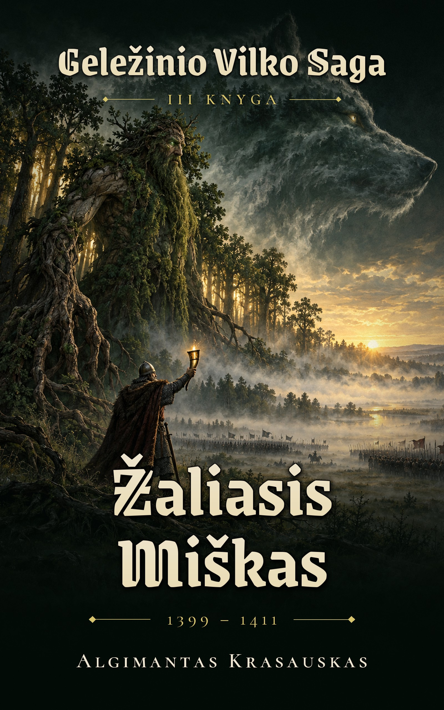
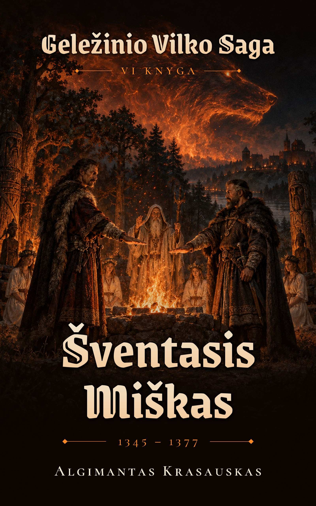

# Geležinio Vilko Saga (The Iron Wolf Saga)




"Geležinio Vilko Saga" yra epinis tamsiosios fantastikos pasakojimas apie XIV amžiaus pabaigos Lietuvą — laiką, kai brolžudiškos kovos, senieji dievai ir plieninė Ordinų tvarka susidūrė viename kruviname mazge.

## I Knyga: Vilko Tremtis (The Wolf's Exile)


Pirmas sagos tomas pasakoja apie Kunigaikščio Vytauto nuosmukį, išdavystę ir transformaciją. Po klastingos tėvo Kęstučio mirties Krėvos požemiuose, Vytautas turi tapti tuo, ko labiausiai bijojo — negailestingu politiniu žaidėju, kad susigrąžintų savo tėvų žemę.

### Skyrių apžvalga

Knyga susideda iš trijų pagrindinių dalių, kurios veda skaitytoją per Vytauto sielos skilinėjimą ir šalies likimo lūžį.

#### I dalis: Nuosmukis
Šioje dalyje stebime paskutines taikos dienas Trakuose ir klastingą spąstų parengimą Vilniuje.
*   **Senasis Šernas** & **Vilko Perspėjimas**: Kęstučio pasitikėjimas ir Vytauto nuojauta susiduria.
*   **Gintaro Sapnas**: Mistinis Birutės ryšys su jūra ir pranašiški regėjimai.
*   **Geležiniai Vartai** & **Krėvos Požemiai**: Spąstai užsidaro. Kęstutis nužudomas, o Vytautas lieka vienas prieš savo mirtinus pusbrolius.

#### II dalis: Pabėgimas
Tai išgyvenimo ir magiškojo realizmo dalis, kurioje mirtingi veiksmai susipina su gamtos dvasių pagalba.
*   **Našlė** & **Keitimas**: Birutės sielvartas ir klastingas Vytauto pabėgimas iš Krėvos persirengus moterimi.
*   **Pelkės Vaikai**: Susitikimas su Egle ir girios paslapčių apsauga.
*   **Velnio Sandėris**: Vytautas knežina savo garbę prieš Marienburgo Magistrą, pasirinkdamas mirtiną sąjungą su didžiausiais priešais.

#### III dalis: Karas ir Tvarka
Sugrįžimas namo ne kaip herojaus, o kaip keršytojo, atsivedusio svetimą ugnį.
*   **Svetimi Dievai** & **Pirmoji Kova**: Lietuva dega nuo Vytauto atvestų sąjungininkų riterių rankų.
*   **Vilniaus Apgultis** & **Pasirinkimas**: Lemtinga naktis, kai Vytautas turi nuspręsti — tapti Ordino marionete ar antrą kartą išduoti visus, kad išgelbėtų tėvų sostinę.
*   **Gintaro Auka** & **Krikštas**: Senųjų Dievų pasitraukimas, Birutės metafizinis išėjimas ir naujo, ledinio krikščioniško amžiaus pradžia.

---

## II Knyga: Auksinis Šešėlis (The Golden Shadow), 1387–1399



Tylioji Sutartis mirusi, o Vytautas, laikydamas slaptą liepsną Trakų pamatuose, ambicijos vedamas antrą kartą pasuka pas Ordiną. Antroji išdavystė, sūnų netektis, Astravo susitarimas, imperija nuo Baltijos iki Juodosios jūros ir Vorsklos mūšis — knyga, kurioje herojus pralaimi. Trys dalys: *Antroji Išdavystė*, *Imperijos Sapnas*, *Kraujo Horizontas*.

📖 **[Skaitykite II knygą internete](https://Algiras.github.io/wolf-saga/2/)** · [Anonsas](books/2_teaser.md)

---

## III Knyga: Žaliasis Miškas (The Green Wood), 1399–1411



Po Vorsklos pelenų: Žemaitijos sukilimai, Galmino giria, Žalgirio mūšis ir Torunės taika, grąžinanti Žemaitiją tik dviem gyvenimams.

📖 **[Skaityti internete](https://Algiras.github.io/wolf-saga/3/)**

---

## VI Knyga: Šventasis Miškas (The Holy Forest) — priešistorė, 1341–1377



Saga prieš sagą: Algirdas ir Kęstutis Šventaragio slėnyje prisiekia Tyliąją Sutartį, Kęstutis veda gintaro žynę Birutę ir trisdešimt metų moka Sutarties kainą. Knyga baigiasi ten, kur prasideda pirmoji. Trys dalys: *Tylioji Sutartis*, *Jūra ir Ugnis*, *Senasis Šernas*.

📖 **[Skaitykite VI knygą internete](https://Algiras.github.io/wolf-saga/6/)**

---

### Skaityti internete
📖 **[Skaitykite interaktyvią knygos versiją čia](https://Algiras.github.io/wolf-saga/)**

---

### Kaip skaityti
Šis projektas yra sugeneruotas naudojant **Quarto**. 

*   **PDF ir EPUB**: Naujausius failus visada galite atsisiųsti iš **[Releases](https://github.com/Algiras/wolf-saga/releases/tag/latest)** skilties.
*   **Interaktyvi versija**: Prieinama per **[GitHub Pages](https://Algiras.github.io/wolf-saga/)**.

Norėdami sugeneruoti knygą patys lokaliai (kiekviena knyga yra atskiras Quarto projektas):

```bash
cd books
quarto render --to all      # I knyga -> books/_book
cd 2 && quarto render --to all   # II knyga -> books/2/_book
cd ../6 && quarto render --to all  # VI knyga -> books/6/_book
```

### Licencija
Šis kūrinys platinamas pagal **Creative Commons Attribution-NonCommercial-NoDerivs 4.0 International** (CC BY-NC-ND 4.0) licenciją.
