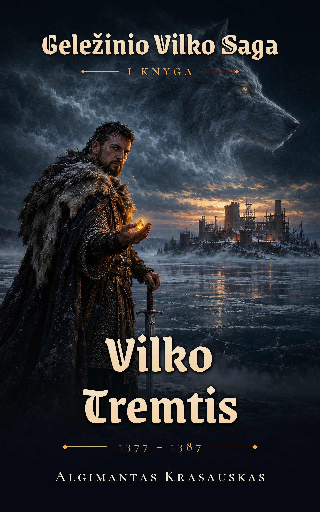
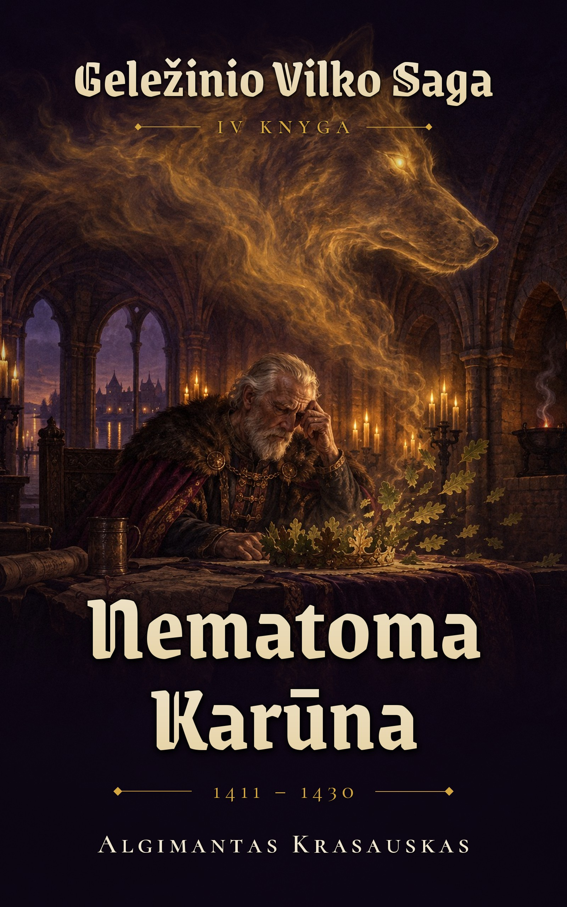
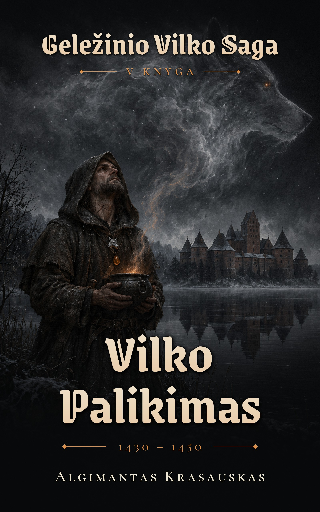

# Geležinio Vilko Saga


*Geležinio Vilko Saga* is an epic dark-fantasy saga about Lithuania from 1341 to 1450. Historical events are the backbone; myth explains why they happened, never whether. It runs to six books: five in the main series and one prequel.

📖 **[Read online](https://Algiras.github.io/wolf-saga/)** · 🧭 **[Reading order](https://Algiras.github.io/wolf-saga/skaitymo_tvarka.html)** · 🗺️ **[Wiki](https://Algiras.github.io/wolf-saga/wiki/)** · ⬇️ **[PDF and EPUB](https://github.com/Algiras/wolf-saga/releases/tag/latest)**

| | Book | Years | |
|---|---|---|---|
|  | **I · Vilko Tremtis** | 1377–1387 | [Read](https://Algiras.github.io/wolf-saga/) |
|  | **II · Auksinis Šešėlis** | 1387–1399 | [Read](https://Algiras.github.io/wolf-saga/2/) · [Teaser](books/2_teaser.md) |
|  | **III · Žaliasis Miškas** | 1399–1411 | [Read](https://Algiras.github.io/wolf-saga/3/) · [Teaser](books/3_teaser.md) |
|  | **IV · Nematoma Karūna** | 1411–1430 | [Read](https://Algiras.github.io/wolf-saga/4/) · [Teaser](books/4_teaser.md) |
|  | **V · Vilko Palikimas** | 1430–1450 | [Read](https://Algiras.github.io/wolf-saga/5/) · [Teaser](books/5_teaser.md) |
|  | **VI · Šventasis Miškas** (prequel) | 1341–1377 | [Read](https://Algiras.github.io/wolf-saga/6/) · [Teaser](books/6_teaser.md) |

At the end of each book a historical note (*Istorinė pastaba*) sets out what is historical fact and what is the saga's invention.

## Building it yourself

Each book is its own [Quarto](https://quarto.org) project:

```bash
cd books && quarto render --to all      # Book I  -> books/_book
cd books/2 && quarto render --to all    # Books II-VI -> books/N/_book
```

## Licence

**Algimantas Krasauskas**, © 2025–2026. The books are published under the [Creative Commons Attribution-NonCommercial-ShareAlike 4.0 International](https://creativecommons.org/licenses/by-nc-sa/4.0/deed.lt) (CC BY-NC-SA 4.0) licence. You may share and adapt them non-commercially, with attribution, under the same licence.
