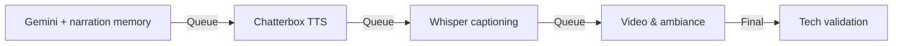

# Audiobook Generation for "Geležinio Vilko Saga" (I knyga: Vilko Tremtis)

This directory contains the pipeline that turns the book text in `books/` into an audiobook. It uses:
- **Google Gemini** for text preprocessing (natural narration), via `GEMINI_API_KEY` and `GEMINI_MODEL`
- **Chatterbox-Turbo TTS** (ResembleAI) for speech synthesis, with optional zero-shot voice cloning
- **ffmpeg** (external binary) for concatenation, video rendering and validation

> **Known limitations, pipeline under redesign.** The video and YouTube stages (4 and 5 below, and `generate_chapter_videos.py`) are being reworked. Output formats, captions and upload metadata may change. See `VIDEO_PIPELINE_REVIEW.md` for the current review and open issues.

## Prerequisites

- Python 3.10+ and `pip install -r requirements.txt` (run from `audiobook/`)
- `ffmpeg` and `ffprobe` on `PATH`
- A Gemini API key: `export GEMINI_API_KEY=...` (`GOOGLE_API_KEY` is also accepted)
- Optional: a CUDA GPU for faster TTS (CPU works, but is much slower)

Optional environment variables for Stage 1:

| Variable | Default | Purpose |
|----------|---------|---------|
| `GEMINI_MODEL` | `gemini-2.5-flash` | Model used for preprocessing |
| `GEMINI_EDITOR_MODEL` | same as `GEMINI_MODEL` | Model used for the editor pass |
| `GEMINI_EMBEDDING_MODEL` | `text-embedding-004` | Embeddings for the narration memory |

## Quick Start (Using Default Voice)

The easiest way to generate the audiobook is with Chatterbox's built-in default voice:

```bash
cd audiobook/
python generate_complete_audiobook.py
```

This will:
1. Generate the intro with the default voice
2. Process all chapters (uses cached preprocessing if available)
3. Generate all chapter audio with the default voice
4. Generate the outro with the default voice
5. Concatenate everything into `GelezinioVilkoSaga_Book1_Complete.wav` in `audiobook/`

No reference audio is required.

## Custom Voice (Optional)

To use a specific narrator voice, pass a reference clip (WAV, roughly 5-30 seconds of clean speech):

```bash
python generate_complete_audiobook.py --reference-audio your_voice.wav
```

Only use voices you have the rights to (your own recordings, or voices you are licensed to use for published audio).

## Pipeline Overview

- **Zero-shot TTS**: Chatterbox-Turbo can clone a voice from a short reference clip
- **Chapter-by-chapter**: Generates a separate audio file for each chapter
- **Narration memory**: Later chapters are preprocessed with context from earlier ones
- **GPU accelerated**: Uses CUDA when available (`--device cuda`, otherwise CPU)

## Usage

### Complete Pipeline (Recommended)

Run the entire pipeline with one command:

```bash
python generate_complete_audiobook.py
```

It runs three stages:
1. **Stage 1**: Text preprocessing with Gemini
2. **Stage 2**: Audio generation with Chatterbox-Turbo TTS
3. **Stage 3**: Concatenation into the final audiobook

**Output**: `GelezinioVilkoSaga_Book1_Complete.wav` (in `audiobook/`)

Useful flags: `--reference-audio PATH`, `--skip-preprocessing`, `--skip-video`.

---

### Manual Stage-by-Stage Workflow

For more control, or to resume from a specific stage:

**Stage 1: Text preprocessing**
```bash
python 1_preprocess_with_ollama.py
```
- Transforms book chapters into narration text with Gemini (the filename is historical; the LLM is Gemini)
- Outputs to `preprocessed/` and writes `preprocessed/manifest.json`

**Stage 2: Audio generation**
```bash
python 2_generate_audio.py --device cpu
```
- Converts preprocessed text to speech with Chatterbox-Turbo
- Writes individual chapter WAV files to `output/`

**Stage 3: Audio concatenation**
```bash
python 3_concatenate_audio.py
```
- Combines the chapter WAV files and normalises them
- Writes `GelezinioVilkoSaga_Book1_Complete.wav`

---

### Options

**CPU mode (no GPU)**:
```bash
python 2_generate_audio.py --device cpu
```

**Different Gemini model (Stage 1)**: set the environment variable, there is no CLI flag:
```bash
GEMINI_MODEL=gemini-2.5-pro python 1_preprocess_with_ollama.py
```

**Validate the master file (Stage 5)**: defaults to `GelezinioVilkoSaga_Book1_Complete.wav`:
```bash
python 5_technical_validation.py
python 5_technical_validation.py --audio /path/to/other_master.wav
```

## Output

### Stage 1: Preprocessed text
```
audiobook/preprocessed/
├── 00_<chapter>.txt
├── 01_<chapter>.txt
├── ...
└── manifest.json
```

### Stage 2: Individual chapter audio
```
audiobook/output/
├── 00_<chapter>.wav
├── 01_<chapter>.wav
└── ...
```

### Stage 3: Final audiobook
```
audiobook/GelezinioVilkoSaga_Book1_Complete.wav
```

### High-performance streaming pipeline
`generate_complete_audiobook.py` streams chapters through all stages with parallel queues, so narration and captioning start as soon as the first chapter's text is ready:
```bash
python generate_complete_audiobook.py --reference-audio your_voice.wav
```

### Stages 4 and 5 (video and QC)
1. **Stage 4 (YouTube video)**: `4_generate_youtube_video.py` (cover image, waveform, optional captions with `--captions`)
2. **Stage 5 (verification)**: `5_technical_validation.py` (ACX/Audible level checks)

Other helpers:
- `generate_chapter_videos.py`: one folder per chapter under `output/youtube_uploads/`, each with an MP4 and a `description.txt`
- `generate_youtube_colorful.py` / `generate_youtube_waveform.py`: single full-book videos with a waveform overlay

## Pipeline Architecture


- **Narration memory**: Later chapters "remember" earlier ones, keeping narrative consistency.
- **Normalisation**: Masters are normalised by the concatenation stage (see `3_concatenate_audio.py`).
- **Verification**: Stage 5 checks sample rate, peak level and RMS loudness.

## Voices

- The narrator clip and character clips are read from local files under `audiobook/` (see `2_generate_audio.py`).
- `download_voice_references.py` cuts clips from YouTube videos. It refuses to run without `--i-own-the-rights`, which you should pass only if every clip is your own recording or a voice you are licensed to use for published audio.

## Technical Details

- **Model**: Chatterbox-Turbo (ResembleAI)
- **Sample rate**: 24 kHz for TTS output
- **Format**: WAV (uncompressed) for intermediate and master files
- **Processing**: Removes LaTeX, citations and markdown formatting before narration
- **Paralinguistic tags**: Supports [chuckle], [sigh], [pause], [emphasis]

## Troubleshooting

### CUDA out of memory
Run the TTS stage on CPU:
```bash
python 2_generate_audio.py --device cpu
```

### Missing dependencies
Install PyTorch with CUDA support first, then the rest of the requirements:
```bash
pip install torch torchaudio --index-url https://download.pytorch.org/whl/cu121
pip install -r requirements.txt
```

### Gemini errors
Check that `GEMINI_API_KEY` (or `GOOGLE_API_KEY`) is exported in the shell that runs Stage 1.

## License

Part of the Geležinio Vilko Saga project, licensed under [CC BY-NC-SA 4.0](../LICENSE). Narration is generated with AI text-to-speech. See the project's `LICENSE` for terms.
