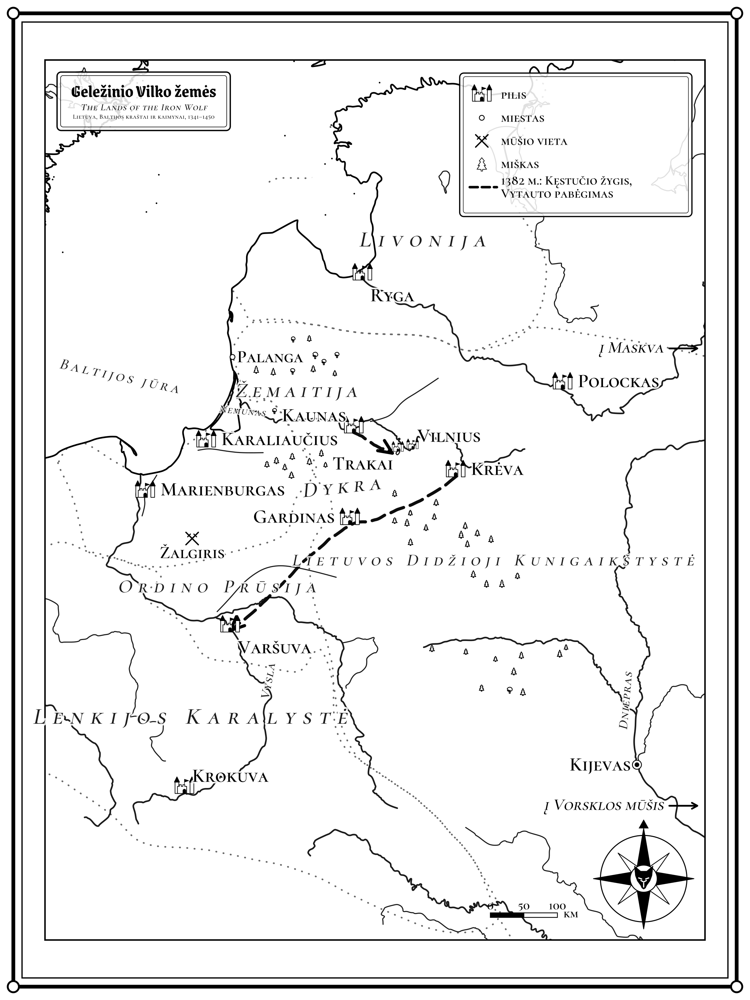
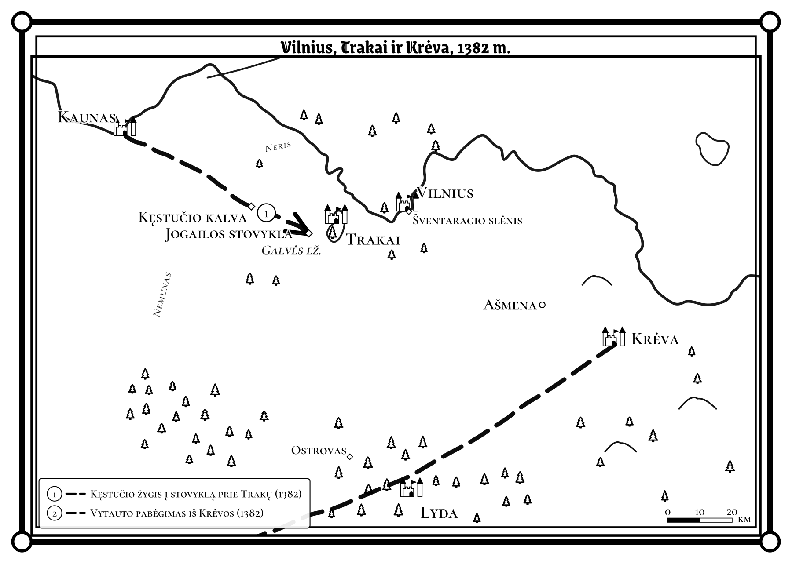
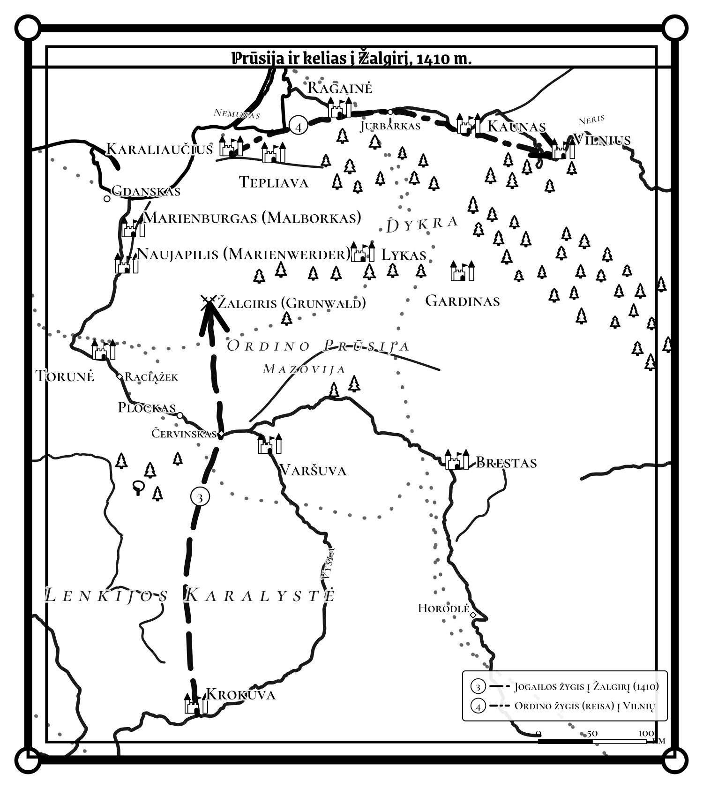

# Žemėlapis {.unnumbered}

{fig-alt="Žemėlapis: Lietuva, Prūsija, Livonija ir Lenkija 1341–1450 metais. Vilnius, Trakai, Krėva ir Kaunas šiaurės vakarų Lietuvoje, Marienburgas ir Karaliaučius Ordino Prūsijoje pajūryje, Ryga Livonijoje, Varšuva ir Krokuva Lenkijoje, Polockas, Smolenskas ir Kijevas rytuose. Punktyrinė linija rodo 1382 metų Kęstučio žygį ir Vytauto pabėgimą." width=4.2in fig-align="center"}



{fig-alt="Vilnius, Trakai ir Krėva 1382 metais: Kęstučio žygis į stovyklą prie Trakų ir Vytauto pabėgimas iš Krėvos." width=4.3in fig-align="center"}

{fig-alt="Prūsija ir kelias į Žalgirį 1410 metais: Jogailos žygis iš Krokuvos į Žalgirį ir Ordino reisa į Vilnių." width=3.6in fig-align="center"}
