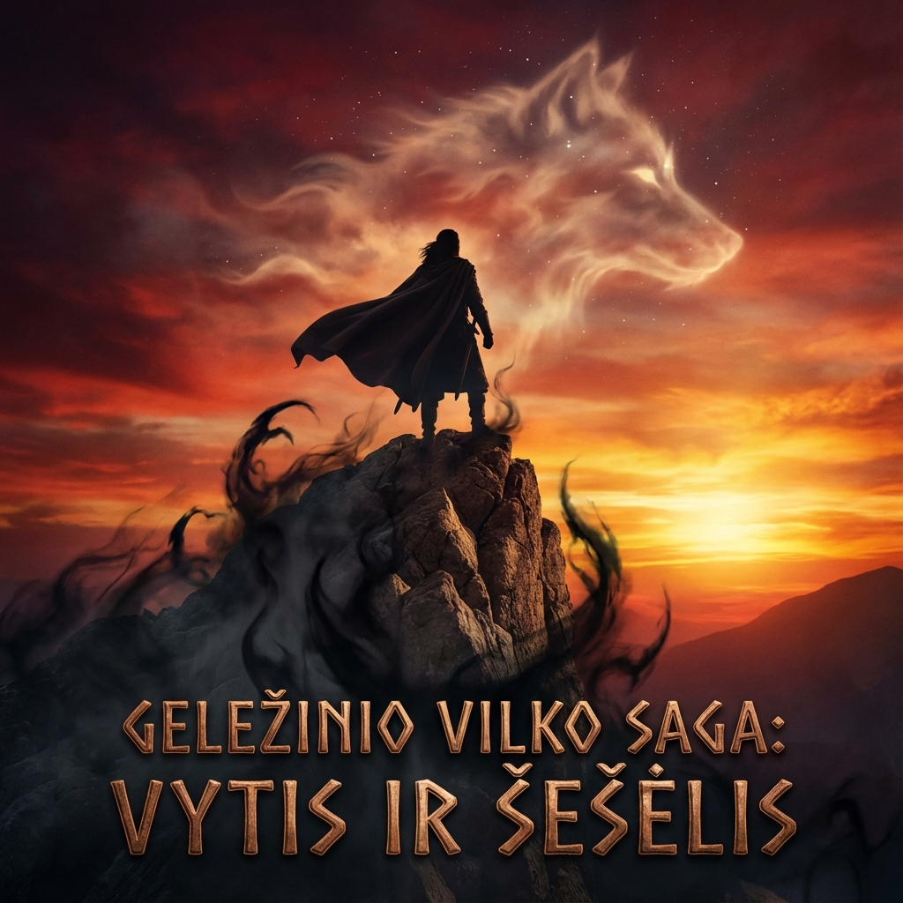

# Geležinio Vilko Saga: 2 Knygos Anonsas

Šis puslapis skirtas antrosios sagos dalies — **„Auksinis Šešėlis“** (1387–1399) — anonsui.

### Trumpa apžvalga

Tėvas pasmaugtas Krėvoje, Šventoji ugnis Vilniuje užgesinta, o Vytautas turi lenkti galvą pusbroliui, laikiusiam virvę. Jam liko tik viena paslaptis: maža liepsna, slapčia saugoma nebaigtos salos pilies pamatuose. Šį kartą jį veda ne kerštas, o ambicija. Ji dar kartą nuves jį pas Ordiną ir pareikalaus kainos, kurios nė vienas tėvas neturėtų mokėti. Imperija, kurią jis ima kurti nuo jūros iki jūros, auga, o kartu auga ir jos šešėlis. Bet ar auksas atlaikys stepės vėją?

*Greitai...*
