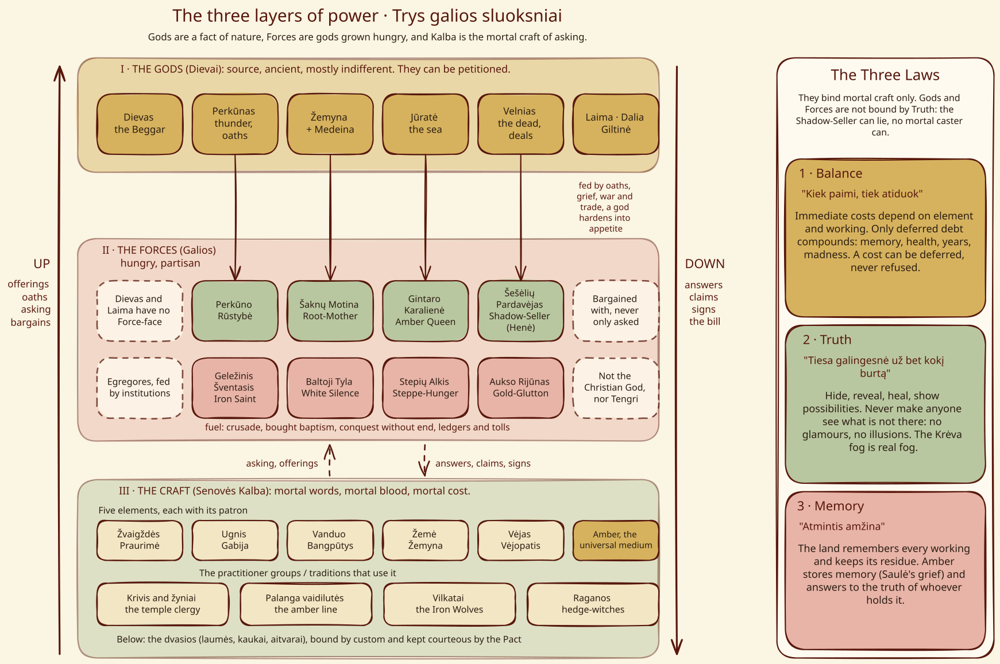
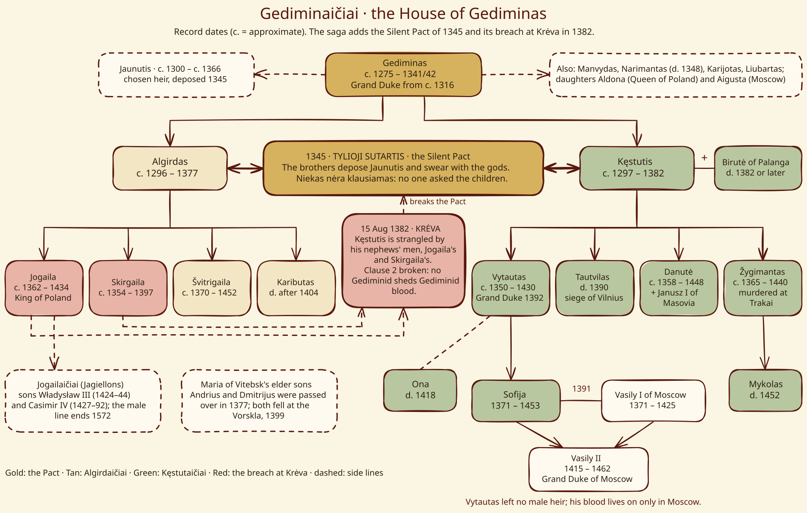
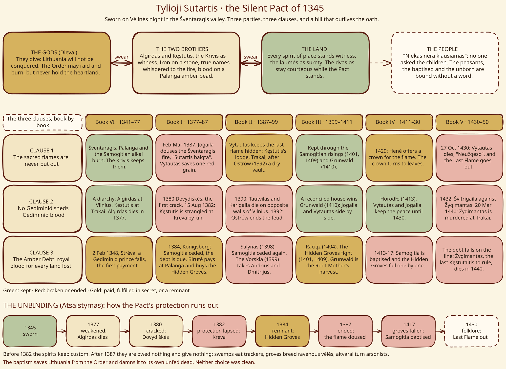
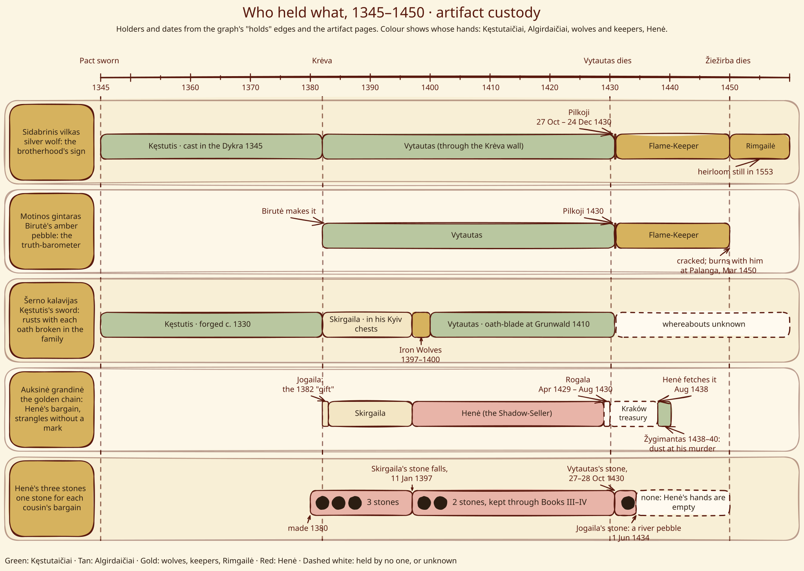
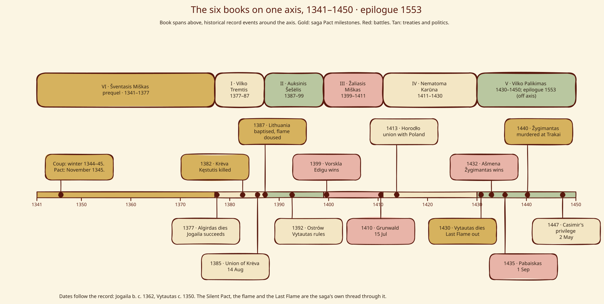

Hand-drawn diagrams of the saga's structure. Each one has an editable [Excalidraw](https://excalidraw.com) source file: open it there, or drop it onto the canvas, to change it.

## The three layers of power

{fig-alt="Three layers of power: the gods, the forces (Root-Mother, Perkūno Rūstybė, Amber Queen, Shadow-Seller and the egregores) and the Kalba craft with its human schools. Offerings and asking flow up, answers and costs flow down. A side panel lists the Three Laws: Balance, Truth and Memory."}

Gods are facts of nature, Forces are gods grown hungry, and Kalba is the mortal craft of asking. Offerings rise; answers, claims and costs come down. The Three Laws bind mortals only. See [Cosmology](codex/cosmology.qmd) and [Root-Mother](forces/root_mother.qmd). *[Editable source](diagrams/cosmology-layers.excalidraw).*

## The House of Gediminas

{fig-alt="Family tree of the House of Gediminas: Gediminas, his sons Jaunutis, Algirdas and Kęstutis, the sons of Algirdas and of Kęstutis, and Vytautas's daughter Sofija married to Vasily I of Moscow. The 1345 Silent Pact joins the two brothers; the 1382 killing of Kęstutis at Krėva breaks it."}

Record dates, with the saga's Pact of 1345 and its breach at Krėva in 1382 marked on the tree. See [Gediminaičiai](houses/gediminaiciai.qmd). *[Editable source](diagrams/gediminid-tree.excalidraw).*

## The Silent Pact

{fig-alt="Diagram of the Silent Pact of 1345: the gods, the two brothers, the land and the unasked people; three clauses (the flames, Gediminid blood, the Amber Debt) traced through Books VI and I to V as kept, broken or paid; and the stages of the Unbinding from 1345 to 1430."}

Three parties and a fourth who was never asked; three clauses followed book by book; and the Unbinding that runs from Krėva to the last flame. See [Tylioji Sutartis](magic/silent_pact.qmd). *[Editable source](diagrams/silent-pact.excalidraw).*

## Artifact custody

{fig-alt="Swimlane timeline from 1345 to 1450 showing who held the silver wolf, the amber pebble, Kęstutis's sword, the golden chain and Henė's three stones, with the stones falling from three to two in 1397, to one in October 1430 and to none on 1 June 1434."}

Five artifacts, 1345 to 1450, taken from the graph's *holds* edges. See [Sidabrinis vilkas](artifacts/silver_wolf.qmd). *[Editable source](diagrams/artifact-custody.excalidraw).*

## The series on one axis

{fig-alt="The six books as spans on one axis from 1341 to 1450, with fourteen record events from the 1345 diarchy to Casimir's 1447 privilege."}

The six books laid over the record: Book VI first, then I to V, with the events that carry the story. See the full [Timeline](timeline.qmd). *[Editable source](diagrams/series-timeline.excalidraw).*
