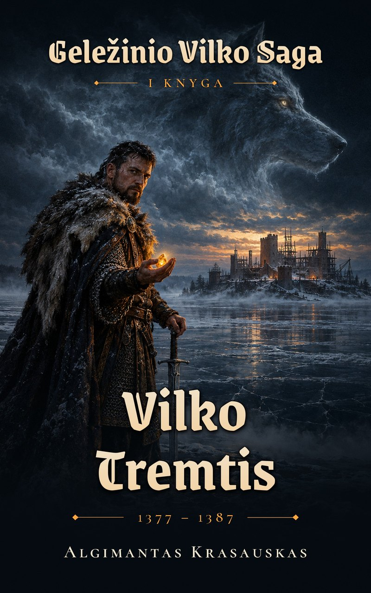
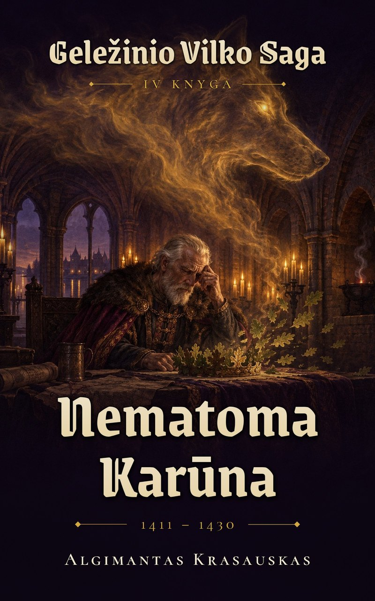
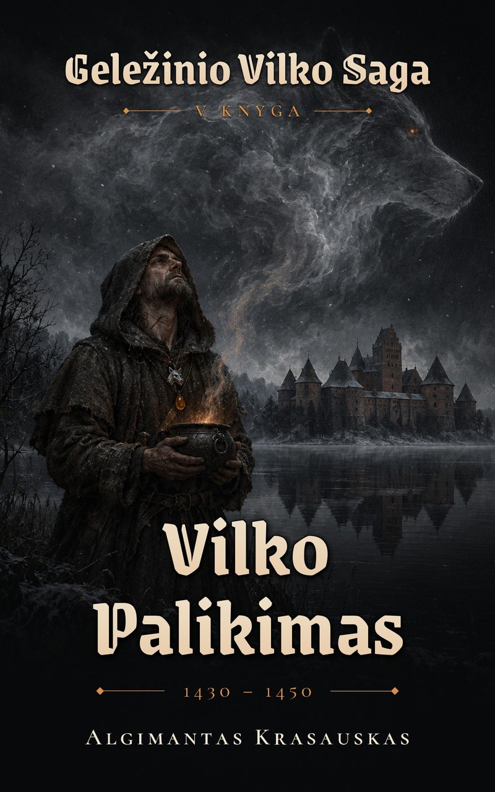

The encyclopedia of the **Iron Wolf Saga**: Lithuania, 1341–1450, where the folklore is literally true and the folk are only ever half right.

## The six books

<a class="cover-card" href="books/book1.html">I · Vilko Tremtis1377–1387</a>
<a class="cover-card" href="books/book2.html">II · Auksinis Šešėlis1387–1399</a>
<a class="cover-card" href="books/book3.html">III · Žaliasis Miškas1399–1411</a>
<a class="cover-card" href="books/book4.html">IV · Nematoma Karūna1411–1430</a>
<a class="cover-card" href="books/book5.html">V · Vilko Palikimas1430–1450</a>
<a class="cover-card" href="books/book6.html">VI · Šventasis Miškas1341–1377 · prequel</a>

## Explore the world

- **[Timeline](timeline.qmd)**: every event, record (✦) and saga invention (◇)
- **[Characters](characters/index.qmd)** · **[Houses](houses/index.qmd)** · **[Factions](factions/index.qmd)** · **[Places](places/index.qmd)**
- **[Gods](gods/index.qmd)** · **[Forces](forces/index.qmd)** · **[Magic & Pacts](magic/index.qmd)** · **[Artifacts](artifacts/index.qmd)** · **[Creatures](creatures/index.qmd)**
- **[Codex](codex/index.qmd)**: the full world bible (cosmology, magic rules, chronology, bestiary, legends, pronunciation…)

Canon precedence: [Canon decisions](codex/canon-decisions.qmd) › Cosmology / Magic rules / Chronology › everything else.
