# Relation Maps by Book

*Generated by `scripts/validate_world_graph.py` from `world_graph.json`. Do not edit by hand.*

## VI · Šventasis Miškas (prequel) (1341–1377)

91 nodes · 87 relations

```mermaid
graph LR
  aitvaras["Aitvaras (fire-tailed thief)"]
  algirdas["Algirdas"]:::char
  alkanosios_veles["Alkanosios vėlės (the hungry dead)"]
  amber_queen["Gintaro Karalienė (Amber Queen)"]:::force
  ausrine["Aušrinė (the morning star)"]:::god
  bargain["Sandėris (bargain)"]:::school
  barstukai["Barstukai (under-elder miners)"]
  bebalsiai["Bebalsiai (the Voiceless)"]
  birute["Birutė"]:::char
  claim["Žymė (claim)"]:::school
  danute["Danutė"]:::char
  edigu["Edigu"]:::char
  el_stars["Žvaigždės (Stars)"]:::school
  el_water["Vanduo (Water)"]:::school
  gabija["Gabija"]:::god
  galminas["Galminas"]:::char
  gdl["Grand Duchy of Lithuania"]:::fac
  gediminaiciai["Gediminaičiai (House of Gediminas)"]
  gediminas["Gediminas"]:::char
  gelezinis_vilkas["Geležinis Vilkas (the Iron Wolf omen)"]
  giltine["Giltinė"]:::god
  gintaryste["Gintarystė (amber-craft)"]:::school
  girinis["Girinis / miškinis (grove-keepers)"]
  gold_glutton["Aukso Rijūnas (Mercator-Rex)"]:::force
  golden_horde["Golden Horde"]:::fac
  hanse["Hanseatic merchants"]:::fac
  hohenstein["Günther von Hohenstein (invented Order brother)"]:::char
  iron_gift["Iron Saint's fearlessness"]:::school
  iron_saint["Geležinis Šventasis (Ferrum Sanctum)"]:::force
  iron_wolves["Vilkatai (Iron Wolves)"]:::fac
  janusz1["Janusz I of Masovia"]:::char
  jogaila["Jogaila"]:::char
  jurate["Jūratė"]:::god
  kalba["Senovės Kalba"]:::school
  kaributas["Kaributas"]:::char
  kaukas["Kaukas / barzdukai (field-luck)"]
  kestutaiciai["Kęstutaičiai (Kęstutis's line)"]:::fac
  kestutis["Kęstutis"]:::char
  kestutis_sword["Šerno kalavijas (Kęstutis's sword)"]:::art
  kniprode["Winrich von Kniprode"]:::char
  laima["Laima"]:::god
  laumes["Laumės (weavers by the water)"]
  laumiukai["Laumiukai (changelings)"]
  medeina["Medeina"]:::god
  menuo["Mėnuo"]:::god
  milzinai["Milžinai (giants)"]
  moscow["Grand Principality of Moscow"]:::fac
  mykolas["Mykolas Žygimantaitis"]:::char
  nedegintieji["Nedegintieji (the Unburned)"]
  ona["Ona"]:::char
  pagan_clergy["Pagan clergy (Krivis, žyniai, vaidilutės)"]:::fac
  palanga_vaidilutes["Palanga amber-priestess line (Gintaro vaidilutės)"]
  perkunas["Perkūnas"]:::god
  perkuno_rustybe["Perkūno Rūstybė"]:::force
  pincuikas["Pinčiukas (clerk of small bargains)"]
  poland["Kingdom of Poland (Lesser Poland lords)"]:::fac
  priesaika["Priesaika (oath-binding)"]:::school
  reizos_raiteliai["Reizos raiteliai (Riders of the Reise)"]
  root_mother["Šaknų Motina (Root-Mother)"]:::force
  rurikids["Rurikids of Moscow"]
  saule["Saulė"]:::god
  shadow_seller["Šešėlių Pardavėjas / Henė"]:::force
  silent_pact["Tylioji Sutartis (Silent Pact)"]:::pact
  silver_wolf["Sidabrinis vilkas (Kęstutis's amulet)"]:::art
  skaiciuotojas["Skaičiuotojas (the Counter)"]
  skirgaila["Skirgaila"]:::char
  slogutis["Slogutis (the presser)"]
  smakas["Smakas (the dragon under the cathedral)"]
  sofija["Sofija Vytautaitė"]:::char
  steppe_hunger["Stepių Alkis (Erdene-Chuluu)"]:::force
  svitrigaila["Švitrigaila"]:::char
  tautvilas["Tautvilas Kęstutaitis (Kondrat)"]:::char
  teutonic_order["Teutonic Order"]:::fac
  uzgesiles["Užgesėlės (the Quenched)"]
  uzkalbejimai["Užkalbėjimai (charms)"]:::school
  vandenis["Vandenis and undinės (lake-keepers)"]
  vejopatis["Vėjopatis"]:::god
  veles["Vėlės (the fed dead)"]
  velnias["Velnias"]:::god
  velnio_pavidalai["Velnias's small shapes (velniukai)"]
  vilkatas["Vilkatas / vilkolakis (cursed werewolf)"]
  vytautas["Vytautas"]:::char
  vytautas_sons["Vytautas's sons Jurgis and Ivanas (hostages; contested)"]:::char
  white_silence["Baltoji Tyla (White Silence)"]:::force
  white_touch["White Silence's frost-touch"]:::school
  wolf_change["Vilkų krikštas (wolf-change)"]:::school
  wolf_skull["Geležinio Vilko kaukolė"]:::art
  zaltvyksles["Žaltvykslės (bog-lights, treasure-flames)"]
  zaltys["Žaltys (household grass snake)"]
  zemyna["Žemyna"]:::god
  zygimantas["Žygimantas Kęstutaitis"]:::char
  gediminas -->|parent_of| algirdas
  gediminas -->|parent_of| kestutis
  algirdas -->|parent_of| jogaila
  algirdas -->|parent_of| skirgaila
  algirdas -->|parent_of| svitrigaila
  algirdas -->|parent_of| kaributas
  kestutis -->|spouse_of| birute
  kestutis -->|parent_of| vytautas
  birute -->|parent_of| vytautas
  kestutis -->|parent_of| zygimantas
  kestutis -->|parent_of| danute
  danute -->|spouse_of| janusz1
  vytautas -->|spouse_of| ona
  vytautas -->|parent_of| sofija
  vytautas -->|parent_of| vytautas_sons
  algirdas -->|rules| gdl
  kestutis -->|rules| gdl
  jogaila -->|rules| gdl
  kniprode -->|rules| teutonic_order
  root_mother -->|face_of| zemyna
  root_mother -->|face_of| medeina
  perkuno_rustybe -->|face_of| perkunas
  shadow_seller -->|shard_of| velnias
  amber_queen -->|face_of| jurate
  iron_saint -.->|egregore_fed_by| teutonic_order
  white_silence -.->|egregore_fed_by| poland
  steppe_hunger -.->|egregore_fed_by| golden_horde
  gold_glutton -.->|egregore_fed_by| hanse
  jurate -->|vessel_of| amber_queen
  galminas -->|vessel_of| root_mother
  perkuno_rustybe -.->|claims| kestutis
  root_mother -.->|patron_of| iron_wolves
  amber_queen -.->|patron_of| kestutaiciai
  steppe_hunger -.->|patron_of| edigu
  gintaryste -->|binds| kalba
  saule -.->|patron_of| gintaryste
  perkunas -.->|patron_of| priesaika
  zemyna -.->|patron_of| priesaika
  laima -.->|patron_of| el_stars
  root_mother -.->|patron_of| wolf_change
  perkuno_rustybe -.->|patron_of| claim
  iron_saint -.->|patron_of| iron_gift
  white_silence -.->|patron_of| white_touch
  shadow_seller -.->|patron_of| bargain
  silent_pact -->|binds| algirdas
  silent_pact -->|binds| kestutis
  silent_pact -->|binds| pagan_clergy
  kestutis -->|holds| kestutis_sword
  kestutis -->|holds| silver_wolf
  iron_wolves -->|holds| wolf_skull
  giltine -->|servant_of| laima
  menuo -.->|patron_of| el_water
  laima -.->|patron_of| uzkalbejimai
  gediminaiciai -->|rules| gdl
  silent_pact -->|binds| gediminaiciai
  rurikids -->|rules| moscow
  amber_queen -.->|patron_of| palanga_vaidilutes
  zaltys -->|servant_of| root_mother
  aitvaras -->|servant_of| velnias
  kaukas -->|servant_of| zemyna
  barstukai -->|servant_of| root_mother
  laumes -->|surety_for| silent_pact
  laumiukai -->|servant_of| laumes
  vandenis -->|servant_of| jurate
  zaltvyksles -->|servant_of| velnias
  girinis -->|shard_of| root_mother
  vilkatas -->|servant_of| velnias
  milzinai -->|servant_of| zemyna
  smakas -->|shard_of| zaltys
  veles -->|servant_of| vejopatis
  alkanosios_veles -->|shard_of| veles
  velnio_pavidalai -->|shard_of| velnias
  pincuikas -->|servant_of| shadow_seller
  gelezinis_vilkas -->|servant_of| gediminaiciai
  nedegintieji -->|shard_of| alkanosios_veles
  nedegintieji -->|servant_of| iron_saint
  reizos_raiteliai -->|servant_of| iron_saint
  bebalsiai -->|servant_of| white_silence
  uzgesiles -->|shard_of| gabija
  skaiciuotojas -->|servant_of| gold_glutton
  hohenstein -->|ally_of| kestutis
  kestutis -->|parent_of| tautvilas
  zygimantas -->|parent_of| mykolas
  saule -->|spouse_of| menuo
  menuo -->|ally_of| ausrine
  medeina -.->|patron_of| girinis
  slogutis -->|servant_of| velnias
  classDef char fill:#f3efe6,stroke:#6b5b3e,color:#222
  classDef force fill:#2d2a3e,stroke:#a08cff,color:#fff
  classDef god fill:#1f3b4d,stroke:#7fc8f8,color:#fff
  classDef art fill:#f9d77e,stroke:#a8741a,color:#222
  classDef fac fill:#e2e8f0,stroke:#475569,color:#222
  classDef pact fill:#7f1d1d,stroke:#fca5a5,color:#fff
  classDef school fill:#14532d,stroke:#86efac,color:#fff
```

## I · Vilko Tremtis (1377–1387)

108 nodes · 126 relations

```mermaid
graph LR
  aitvaras["Aitvaras (fire-tailed thief)"]
  algirdaiciai["Algirdaičiai (Algirdas's line)"]:::fac
  algirdas["Algirdas"]:::char
  alkanosios_veles["Alkanosios vėlės (the hungry dead)"]
  amber_queen["Gintaro Karalienė (Amber Queen)"]:::force
  ausrine["Aušrinė (the morning star)"]:::god
  bargain["Sandėris (bargain)"]:::school
  barstukai["Barstukai (under-elder miners)"]
  bebalsiai["Bebalsiai (the Voiceless)"]
  birute["Birutė"]:::char
  claim["Žymė (claim)"]:::school
  danute["Danutė"]:::char
  edigu["Edigu"]:::char
  egle["Eglė (vaidilutė → Pelkių Eglė)"]:::char
  el_stars["Žvaigždės (Stars)"]:::school
  el_water["Vanduo (Water)"]:::school
  ember["Paskutinė žarija (Šventaragis ember)"]:::art
  flame_promise["The Last Flame promise"]:::pact
  gabija["Gabija"]:::god
  galminas["Galminas"]:::char
  gdl["Grand Duchy of Lithuania"]:::fac
  gediminaiciai["Gediminaičiai (House of Gediminas)"]
  gelezinis_vilkas["Geležinis Vilkas (the Iron Wolf omen)"]
  giltine["Giltinė"]:::god
  gintaryste["Gintarystė (amber-craft)"]:::school
  girinis["Girinis / miškinis (grove-keepers)"]
  gold_glutton["Aukso Rijūnas (Mercator-Rex)"]:::force
  golden_chain["Auksinė grandinė (the strangling chain)"]:::art
  golden_horde["Golden Horde"]:::fac
  hanse["Hanseatic merchants"]:::fac
  hanulas["Hanulas (Riga merchant)"]:::char
  iron_gift["Iron Saint's fearlessness"]:::school
  iron_saint["Geležinis Šventasis (Ferrum Sanctum)"]:::force
  iron_wolves["Vilkatai (Iron Wolves)"]:::fac
  jadvyga["Jadvyga (Jadwiga)"]:::char
  janusz1["Janusz I of Masovia"]:::char
  jogaila["Jogaila"]:::char
  jogailaiciai["Jogailaičiai (Jagiellonians)"]
  jurate["Jūratė"]:::god
  kalba["Senovės Kalba"]:::school
  kaributas["Kaributas"]:::char
  kaukas["Kaukas / barzdukai (field-luck)"]
  kestutaiciai["Kęstutaičiai (Kęstutis's line)"]:::fac
  kestutis["Kęstutis"]:::char
  kestutis_sword["Šerno kalavijas (Kęstutis's sword)"]:::art
  kniprode["Winrich von Kniprode"]:::char
  laima["Laima"]:::god
  laumes["Laumės (weavers by the water)"]
  laumiukai["Laumiukai (changelings)"]
  liebenstein["Kuno von Liebenstein"]:::char
  marquard["Marquard von Salzbach"]:::char
  masovian_piasts["Masovian Piasts"]
  medeina["Medeina"]:::god
  menuo["Mėnuo"]:::god
  milzinai["Milžinai (giants)"]
  moscow["Grand Principality of Moscow"]:::fac
  mykolas["Mykolas Žygimantaitis"]:::char
  nedegintieji["Nedegintieji (the Unburned)"]
  ona["Ona"]:::char
  order_sword["Kryžiaus kalavijas (the Order's sword)"]:::art
  pagan_clergy["Pagan clergy (Krivis, žyniai, vaidilutės)"]:::fac
  palanga_vaidilutes["Palanga amber-priestess line (Gintaro vaidilutės)"]
  pebble["Motinos gintaras (Birutė's pebble)"]:::art
  perkunas["Perkūnas"]:::god
  perkuno_rustybe["Perkūno Rūstybė"]:::force
  pincuikas["Pinčiukas (clerk of small bargains)"]
  poland["Kingdom of Poland (Lesser Poland lords)"]:::fac
  priesaika["Priesaika (oath-binding)"]:::school
  ragana["Ragana (seer-witch)"]
  reizos_raiteliai["Reizos raiteliai (Riders of the Reise)"]
  root_mother["Šaknų Motina (Root-Mother)"]:::force
  rurikids["Rurikids of Moscow"]
  saule["Saulė"]:::god
  shadow_seller["Šešėlių Pardavėjas / Henė"]:::force
  silent_pact["Tylioji Sutartis (Silent Pact)"]:::pact
  silver_wolf["Sidabrinis vilkas (Kęstutis's amulet)"]:::art
  skaiciuotojas["Skaičiuotojas (the Counter)"]
  skirgaila["Skirgaila"]:::char
  slogutis["Slogutis (the presser)"]
  smakas["Smakas (the dragon under the cathedral)"]
  sofija["Sofija Vytautaitė"]:::char
  steppe_hunger["Stepių Alkis (Erdene-Chuluu)"]:::force
  sutartis_birute["Birutė's Senovės Sutartis over Vytautas"]:::pact
  svitrigaila["Švitrigaila"]:::char
  tautvilas["Tautvilas Kęstutaitis (Kondrat)"]:::char
  teutonic_order["Teutonic Order"]:::fac
  three_stones["Henė's three black stones"]:::art
  tokhtamysh["Tokhtamysh"]:::char
  trakai["Trakai"]
  uzgesiles["Užgesėlės (the Quenched)"]
  uzkalbejimai["Užkalbėjimai (charms)"]:::school
  vandenis["Vandenis and undinės (lake-keepers)"]
  vejopatis["Vėjopatis"]:::god
  veles["Vėlės (the fed dead)"]
  velnias["Velnias"]:::god
  velnio_pavidalai["Velnias's small shapes (velniukai)"]
  vilkatas["Vilkatas / vilkolakis (cursed werewolf)"]
  vytautas["Vytautas"]:::char
  vytautas_sons["Vytautas's sons Jurgis and Ivanas (hostages; contested)"]:::char
  white_silence["Baltoji Tyla (White Silence)"]:::force
  white_touch["White Silence's frost-touch"]:::school
  wolf_change["Vilkų krikštas (wolf-change)"]:::school
  wolf_skull["Geležinio Vilko kaukolė"]:::art
  zaltvyksles["Žaltvykslės (bog-lights, treasure-flames)"]
  zaltys["Žaltys (household grass snake)"]
  zemyna["Žemyna"]:::god
  zollner["Konrad Zöllner von Rotenstein"]:::char
  zygimantas["Žygimantas Kęstutaitis"]:::char
  algirdas -->|parent_of| jogaila
  algirdas -->|parent_of| skirgaila
  algirdas -->|parent_of| svitrigaila
  algirdas -->|parent_of| kaributas
  kestutis -->|spouse_of| birute
  kestutis -->|parent_of| vytautas
  birute -->|parent_of| vytautas
  kestutis -->|parent_of| zygimantas
  kestutis -->|parent_of| danute
  danute -->|spouse_of| janusz1
  vytautas -->|spouse_of| ona
  vytautas -->|parent_of| sofija
  vytautas -->|parent_of| vytautas_sons
  jogaila -->|spouse_of| jadvyga
  algirdas -->|rules| gdl
  kestutis -->|rules| gdl
  jogaila -->|rules| gdl
  skirgaila -->|rules| trakai
  jogaila -->|rules| poland
  jadvyga -->|rules| poland
  kniprode -->|rules| teutonic_order
  zollner -->|rules| teutonic_order
  tokhtamysh -->|rules| golden_horde
  jogaila -->|ally_of| teutonic_order
  jogaila --x|enemy_of| kestutis
  skirgaila --x|enemy_of| kestutis
  vytautas --x|enemy_of| jogaila
  vytautas --x|enemy_of| skirgaila
  vytautas -->|ally_of| janusz1
  vytautas -->|vassal_of| teutonic_order
  vytautas --x|enemy_of| teutonic_order
  ona -->|hostage_of| teutonic_order
  vytautas -->|ally_of| jogaila
  root_mother -->|face_of| zemyna
  root_mother -->|face_of| medeina
  perkuno_rustybe -->|face_of| perkunas
  shadow_seller -->|shard_of| velnias
  amber_queen -->|face_of| jurate
  iron_saint -.->|egregore_fed_by| teutonic_order
  white_silence -.->|egregore_fed_by| poland
  white_silence -.->|egregore_fed_by| algirdaiciai
  steppe_hunger -.->|egregore_fed_by| golden_horde
  gold_glutton -.->|egregore_fed_by| hanse
  birute -->|vessel_of| amber_queen
  jurate -->|vessel_of| amber_queen
  jadvyga -->|vessel_of| white_silence
  galminas -->|vessel_of| root_mother
  egle -->|servant_of| root_mother
  hanulas -.->|mask_of| shadow_seller
  shadow_seller -.->|bargain_with| jogaila
  shadow_seller -.->|bargain_with| skirgaila
  perkuno_rustybe -.->|claims| kestutis
  perkuno_rustybe -.->|claims| vytautas
  root_mother -.->|claims| vytautas
  root_mother -.->|patron_of| iron_wolves
  amber_queen -.->|patron_of| kestutaiciai
  iron_saint -.->|patron_of| zollner
  steppe_hunger -.->|patron_of| edigu
  gintaryste -->|binds| kalba
  saule -.->|patron_of| gintaryste
  perkunas -.->|patron_of| priesaika
  zemyna -.->|patron_of| priesaika
  laima -.->|patron_of| el_stars
  root_mother -.->|patron_of| wolf_change
  perkuno_rustybe -.->|patron_of| claim
  iron_saint -.->|patron_of| iron_gift
  white_silence -.->|patron_of| white_touch
  shadow_seller -.->|patron_of| bargain
  sutartis_birute -->|binds| vytautas
  birute -->|surety_for| vytautas
  flame_promise -->|binds| vytautas
  silent_pact -->|binds| algirdas
  silent_pact -->|binds| kestutis
  silent_pact -->|binds| pagan_clergy
  vytautas -->|holds| pebble
  kestutis -->|holds| kestutis_sword
  skirgaila -->|holds| kestutis_sword
  kestutis -->|holds| silver_wolf
  vytautas -->|holds| silver_wolf
  jogaila -->|holds| golden_chain
  skirgaila -->|holds| golden_chain
  vytautas -->|holds| ember
  vytautas -->|holds| order_sword
  shadow_seller -->|holds| three_stones
  iron_wolves -->|holds| wolf_skull
  giltine -->|servant_of| laima
  menuo -.->|patron_of| el_water
  laima -.->|patron_of| uzkalbejimai
  gediminaiciai -->|rules| gdl
  jogailaiciai -->|rules| poland
  silent_pact -->|binds| gediminaiciai
  kestutaiciai -->|ally_of| masovian_piasts
  rurikids -->|rules| moscow
  amber_queen -.->|patron_of| palanga_vaidilutes
  zaltys -->|servant_of| root_mother
  aitvaras -->|servant_of| velnias
  kaukas -->|servant_of| zemyna
  barstukai -->|servant_of| root_mother
  laumes -->|surety_for| silent_pact
  laumiukai -->|servant_of| laumes
  vandenis -->|servant_of| jurate
  zaltvyksles -->|servant_of| velnias
  girinis -->|shard_of| root_mother
  vilkatas -->|servant_of| velnias
  milzinai -->|servant_of| zemyna
  smakas -->|shard_of| zaltys
  veles -->|servant_of| vejopatis
  alkanosios_veles -->|shard_of| veles
  velnio_pavidalai -->|shard_of| velnias
  pincuikas -->|servant_of| shadow_seller
  ragana -.->|bargain_with| velnio_pavidalai
  gelezinis_vilkas -->|servant_of| gediminaiciai
  nedegintieji -->|shard_of| alkanosios_veles
  nedegintieji -->|servant_of| iron_saint
  reizos_raiteliai -->|servant_of| iron_saint
  bebalsiai -->|servant_of| white_silence
  uzgesiles -->|shard_of| gabija
  skaiciuotojas -->|servant_of| gold_glutton
  liebenstein -->|ally_of| kestutis
  kestutis -->|parent_of| tautvilas
  marquard -->|ally_of| vytautas
  zygimantas -->|parent_of| mykolas
  saule -->|spouse_of| menuo
  menuo -->|ally_of| ausrine
  medeina -.->|patron_of| girinis
  slogutis -->|servant_of| velnias
  classDef char fill:#f3efe6,stroke:#6b5b3e,color:#222
  classDef force fill:#2d2a3e,stroke:#a08cff,color:#fff
  classDef god fill:#1f3b4d,stroke:#7fc8f8,color:#fff
  classDef art fill:#f9d77e,stroke:#a8741a,color:#222
  classDef fac fill:#e2e8f0,stroke:#475569,color:#222
  classDef pact fill:#7f1d1d,stroke:#fca5a5,color:#fff
  classDef school fill:#14532d,stroke:#86efac,color:#fff
```

## II · Auksinis Šešėlis (1387–1399)

99 nodes · 114 relations

```mermaid
graph LR
  aitvaras["Aitvaras (fire-tailed thief)"]
  algirdaiciai["Algirdaičiai (Algirdas's line)"]:::fac
  alkanosios_veles["Alkanosios vėlės (the hungry dead)"]
  amber_queen["Gintaro Karalienė (Amber Queen)"]:::force
  ausrine["Aušrinė (the morning star)"]:::god
  bargain["Sandėris (bargain)"]:::school
  barstukai["Barstukai (under-elder miners)"]
  bebalsiai["Bebalsiai (the Voiceless)"]
  claim["Žymė (claim)"]:::school
  danute["Danutė"]:::char
  edigu["Edigu"]:::char
  egle["Eglė (vaidilutė → Pelkių Eglė)"]:::char
  el_stars["Žvaigždės (Stars)"]:::school
  el_water["Vanduo (Water)"]:::school
  ember["Paskutinė žarija (Šventaragis ember)"]:::art
  flame_promise["The Last Flame promise"]:::pact
  gabija["Gabija"]:::god
  galminas["Galminas"]:::char
  gdl["Grand Duchy of Lithuania"]:::fac
  gediminaiciai["Gediminaičiai (House of Gediminas)"]
  gelezinis_vilkas["Geležinis Vilkas (the Iron Wolf omen)"]
  giltine["Giltinė"]:::god
  gintaryste["Gintarystė (amber-craft)"]:::school
  girinis["Girinis / miškinis (grove-keepers)"]
  gold_glutton["Aukso Rijūnas (Mercator-Rex)"]:::force
  golden_chain["Auksinė grandinė (the strangling chain)"]:::art
  golden_horde["Golden Horde"]:::fac
  hanse["Hanseatic merchants"]:::fac
  iron_gift["Iron Saint's fearlessness"]:::school
  iron_saint["Geležinis Šventasis (Ferrum Sanctum)"]:::force
  iron_wolves["Vilkatai (Iron Wolves)"]:::fac
  jadvyga["Jadvyga (Jadwiga)"]:::char
  janusz1["Janusz I of Masovia"]:::char
  jogaila["Jogaila"]:::char
  jogailaiciai["Jogailaičiai (Jagiellonians)"]
  jurate["Jūratė"]:::god
  kalba["Senovės Kalba"]:::school
  kaukas["Kaukas / barzdukai (field-luck)"]
  kestutaiciai["Kęstutaičiai (Kęstutis's line)"]:::fac
  kestutis_sword["Šerno kalavijas (Kęstutis's sword)"]:::art
  laima["Laima"]:::god
  laumes["Laumės (weavers by the water)"]
  laumiukai["Laumiukai (changelings)"]
  marquard["Marquard von Salzbach"]:::char
  masovian_piasts["Masovian Piasts"]
  medeina["Medeina"]:::god
  menuo["Mėnuo"]:::god
  milzinai["Milžinai (giants)"]
  moscow["Grand Principality of Moscow"]:::fac
  mykolas["Mykolas Žygimantaitis"]:::char
  nedegintieji["Nedegintieji (the Unburned)"]
  ona["Ona"]:::char
  pagan_clergy["Pagan clergy (Krivis, žyniai, vaidilutės)"]:::fac
  palanga_vaidilutes["Palanga amber-priestess line (Gintaro vaidilutės)"]
  pebble["Motinos gintaras (Birutė's pebble)"]:::art
  perkunas["Perkūnas"]:::god
  perkuno_rustybe["Perkūno Rūstybė"]:::force
  pincuikas["Pinčiukas (clerk of small bargains)"]
  poland["Kingdom of Poland (Lesser Poland lords)"]:::fac
  priesaika["Priesaika (oath-binding)"]:::school
  ragana["Ragana (seer-witch)"]
  reizos_raiteliai["Reizos raiteliai (Riders of the Reise)"]
  root_mother["Šaknų Motina (Root-Mother)"]:::force
  rurikids["Rurikids of Moscow"]
  saule["Saulė"]:::god
  shadow_seller["Šešėlių Pardavėjas / Henė"]:::force
  silent_pact["Tylioji Sutartis (Silent Pact)"]:::pact
  silver_wolf["Sidabrinis vilkas (Kęstutis's amulet)"]:::art
  skaiciuotojas["Skaičiuotojas (the Counter)"]
  skirgaila["Skirgaila"]:::char
  slogutis["Slogutis (the presser)"]
  smakas["Smakas (the dragon under the cathedral)"]
  sofija["Sofija Vytautaitė"]:::char
  steppe_hunger["Stepių Alkis (Erdene-Chuluu)"]:::force
  sutartis_birute["Birutė's Senovės Sutartis over Vytautas"]:::pact
  teutonic_order["Teutonic Order"]:::fac
  three_stones["Henė's three black stones"]:::art
  tokhtamysh["Tokhtamysh"]:::char
  trakai["Trakai"]
  uzgesiles["Užgesėlės (the Quenched)"]
  uzkalbejimai["Užkalbėjimai (charms)"]:::school
  vandenis["Vandenis and undinės (lake-keepers)"]
  vasily1["Vasily I of Moscow"]:::char
  vejopatis["Vėjopatis"]:::god
  veles["Vėlės (the fed dead)"]
  velnias["Velnias"]:::god
  velnio_pavidalai["Velnias's small shapes (velniukai)"]
  vilkatas["Vilkatas / vilkolakis (cursed werewolf)"]
  vytautas["Vytautas"]:::char
  vytautas_sons["Vytautas's sons Jurgis and Ivanas (hostages; contested)"]:::char
  white_silence["Baltoji Tyla (White Silence)"]:::force
  white_touch["White Silence's frost-touch"]:::school
  wolf_change["Vilkų krikštas (wolf-change)"]:::school
  wolf_skull["Geležinio Vilko kaukolė"]:::art
  zaltvyksles["Žaltvykslės (bog-lights, treasure-flames)"]
  zaltys["Žaltys (household grass snake)"]
  zemyna["Žemyna"]:::god
  zollner["Konrad Zöllner von Rotenstein"]:::char
  zygimantas["Žygimantas Kęstutaitis"]:::char
  danute -->|spouse_of| janusz1
  vytautas -->|spouse_of| ona
  vytautas -->|parent_of| sofija
  vytautas -->|parent_of| vytautas_sons
  sofija -->|spouse_of| vasily1
  jogaila -->|spouse_of| jadvyga
  jogaila -->|rules| gdl
  skirgaila -->|rules| trakai
  vytautas -->|rules| gdl
  jogaila -->|rules| poland
  jadvyga -->|rules| poland
  zollner -->|rules| teutonic_order
  tokhtamysh -->|rules| golden_horde
  edigu -->|rules| golden_horde
  vasily1 -->|rules| moscow
  vytautas --x|enemy_of| skirgaila
  vytautas --x|enemy_of| teutonic_order
  vytautas -->|ally_of| jogaila
  vytautas --x|enemy_of| jogaila
  vytautas -->|ally_of| teutonic_order
  vytautas_sons -->|hostage_of| teutonic_order
  vytautas -->|ally_of| jogaila
  vytautas --x|enemy_of| teutonic_order
  vytautas -->|ally_of| tokhtamysh
  vytautas --x|enemy_of| edigu
  root_mother -->|face_of| zemyna
  root_mother -->|face_of| medeina
  perkuno_rustybe -->|face_of| perkunas
  shadow_seller -->|shard_of| velnias
  amber_queen -->|face_of| jurate
  iron_saint -.->|egregore_fed_by| teutonic_order
  white_silence -.->|egregore_fed_by| poland
  white_silence -.->|egregore_fed_by| algirdaiciai
  steppe_hunger -.->|egregore_fed_by| golden_horde
  gold_glutton -.->|egregore_fed_by| hanse
  jurate -->|vessel_of| amber_queen
  jadvyga -->|vessel_of| white_silence
  galminas -->|vessel_of| root_mother
  egle -->|servant_of| root_mother
  shadow_seller -.->|bargain_with| jogaila
  shadow_seller -.->|bargain_with| skirgaila
  shadow_seller -.->|bargain_with| vytautas
  perkuno_rustybe -.->|claims| vytautas
  root_mother -.->|claims| vytautas
  root_mother -.->|patron_of| iron_wolves
  amber_queen -.->|patron_of| kestutaiciai
  iron_saint -.->|patron_of| zollner
  steppe_hunger -.->|patron_of| edigu
  gintaryste -->|binds| kalba
  saule -.->|patron_of| gintaryste
  perkunas -.->|patron_of| priesaika
  zemyna -.->|patron_of| priesaika
  laima -.->|patron_of| el_stars
  root_mother -.->|patron_of| wolf_change
  perkuno_rustybe -.->|patron_of| claim
  iron_saint -.->|patron_of| iron_gift
  white_silence -.->|patron_of| white_touch
  shadow_seller -.->|patron_of| bargain
  sutartis_birute -->|binds| vytautas
  flame_promise -->|binds| vytautas
  silent_pact -->|binds| pagan_clergy
  vytautas -->|holds| pebble
  skirgaila -->|holds| kestutis_sword
  vytautas -->|holds| silver_wolf
  skirgaila -->|holds| golden_chain
  vytautas -->|holds| ember
  shadow_seller -->|holds| three_stones
  iron_wolves -->|holds| wolf_skull
  shadow_seller -->|holds| golden_chain
  giltine -->|servant_of| laima
  menuo -.->|patron_of| el_water
  laima -.->|patron_of| uzkalbejimai
  zygimantas -->|hostage_of| teutonic_order
  gediminaiciai -->|rules| gdl
  jogailaiciai -->|rules| poland
  silent_pact -->|binds| gediminaiciai
  kestutaiciai -->|ally_of| masovian_piasts
  rurikids -->|rules| moscow
  kestutaiciai -->|ally_of| rurikids
  amber_queen -.->|patron_of| palanga_vaidilutes
  zaltys -->|servant_of| root_mother
  aitvaras -->|servant_of| velnias
  kaukas -->|servant_of| zemyna
  barstukai -->|servant_of| root_mother
  laumes -->|surety_for| silent_pact
  laumiukai -->|servant_of| laumes
  vandenis -->|servant_of| jurate
  zaltvyksles -->|servant_of| velnias
  girinis -->|shard_of| root_mother
  vilkatas -->|servant_of| velnias
  milzinai -->|servant_of| zemyna
  smakas -->|shard_of| zaltys
  veles -->|servant_of| vejopatis
  alkanosios_veles -->|shard_of| veles
  velnio_pavidalai -->|shard_of| velnias
  pincuikas -->|servant_of| shadow_seller
  ragana -.->|bargain_with| velnio_pavidalai
  gelezinis_vilkas -->|servant_of| gediminaiciai
  nedegintieji -->|shard_of| alkanosios_veles
  nedegintieji -->|servant_of| iron_saint
  reizos_raiteliai -->|servant_of| iron_saint
  bebalsiai -->|servant_of| white_silence
  uzgesiles -->|shard_of| gabija
  skaiciuotojas -->|servant_of| gold_glutton
  ona -->|hostage_of| teutonic_order
  sofija -->|hostage_of| teutonic_order
  marquard -->|ally_of| vytautas
  marquard --x|enemy_of| vytautas
  zygimantas -->|parent_of| mykolas
  iron_wolves -->|holds| kestutis_sword
  saule -->|spouse_of| menuo
  menuo -->|ally_of| ausrine
  medeina -.->|patron_of| girinis
  slogutis -->|servant_of| velnias
  classDef char fill:#f3efe6,stroke:#6b5b3e,color:#222
  classDef force fill:#2d2a3e,stroke:#a08cff,color:#fff
  classDef god fill:#1f3b4d,stroke:#7fc8f8,color:#fff
  classDef art fill:#f9d77e,stroke:#a8741a,color:#222
  classDef fac fill:#e2e8f0,stroke:#475569,color:#222
  classDef pact fill:#7f1d1d,stroke:#fca5a5,color:#fff
  classDef school fill:#14532d,stroke:#86efac,color:#fff
```

## III · Žaliasis Miškas (1399–1411)

95 nodes · 98 relations

```mermaid
graph LR
  aitvaras["Aitvaras (fire-tailed thief)"]
  algirdaiciai["Algirdaičiai (Algirdas's line)"]:::fac
  alkanosios_veles["Alkanosios vėlės (the hungry dead)"]
  amber_queen["Gintaro Karalienė (Amber Queen)"]:::force
  ausrine["Aušrinė (the morning star)"]:::god
  bargain["Sandėris (bargain)"]:::school
  barstukai["Barstukai (under-elder miners)"]
  bebalsiai["Bebalsiai (the Voiceless)"]
  claim["Žymė (claim)"]:::school
  danute["Danutė"]:::char
  edigu["Edigu"]:::char
  egle["Eglė (vaidilutė → Pelkių Eglė)"]:::char
  el_stars["Žvaigždės (Stars)"]:::school
  el_water["Vanduo (Water)"]:::school
  ember["Paskutinė žarija (Šventaragis ember)"]:::art
  flame_promise["The Last Flame promise"]:::pact
  gabija["Gabija"]:::god
  galminas["Galminas"]:::char
  gdl["Grand Duchy of Lithuania"]:::fac
  gediminaiciai["Gediminaičiai (House of Gediminas)"]
  gelezinis_vilkas["Geležinis Vilkas (the Iron Wolf omen)"]
  giltine["Giltinė"]:::god
  gintaryste["Gintarystė (amber-craft)"]:::school
  girinis["Girinis / miškinis (grove-keepers)"]
  gold_glutton["Aukso Rijūnas (Mercator-Rex)"]:::force
  golden_chain["Auksinė grandinė (the strangling chain)"]:::art
  golden_horde["Golden Horde"]:::fac
  hanse["Hanseatic merchants"]:::fac
  iron_gift["Iron Saint's fearlessness"]:::school
  iron_saint["Geležinis Šventasis (Ferrum Sanctum)"]:::force
  iron_wolves["Vilkatai (Iron Wolves)"]:::fac
  jadvyga["Jadvyga (Jadwiga)"]:::char
  janusz1["Janusz I of Masovia"]:::char
  jogaila["Jogaila"]:::char
  jogailaiciai["Jogailaičiai (Jagiellonians)"]
  jungingen["Ulrich von Jungingen"]:::char
  jurate["Jūratė"]:::god
  kalba["Senovės Kalba"]:::school
  kaukas["Kaukas / barzdukai (field-luck)"]
  kestutaiciai["Kęstutaičiai (Kęstutis's line)"]:::fac
  kestutis_sword["Šerno kalavijas (Kęstutis's sword)"]:::art
  laima["Laima"]:::god
  laumes["Laumės (weavers by the water)"]
  laumiukai["Laumiukai (changelings)"]
  marquard["Marquard von Salzbach"]:::char
  masovian_piasts["Masovian Piasts"]
  medeina["Medeina"]:::god
  menuo["Mėnuo"]:::god
  milzinai["Milžinai (giants)"]
  moscow["Grand Principality of Moscow"]:::fac
  mykolas["Mykolas Žygimantaitis"]:::char
  nedegintieji["Nedegintieji (the Unburned)"]
  olesnicki["Zbigniew Oleśnicki"]:::char
  ona["Ona"]:::char
  palanga_vaidilutes["Palanga amber-priestess line (Gintaro vaidilutės)"]
  pebble["Motinos gintaras (Birutė's pebble)"]:::art
  perkunas["Perkūnas"]:::god
  perkuno_rustybe["Perkūno Rūstybė"]:::force
  pincuikas["Pinčiukas (clerk of small bargains)"]
  poland["Kingdom of Poland (Lesser Poland lords)"]:::fac
  priesaika["Priesaika (oath-binding)"]:::school
  ragana["Ragana (seer-witch)"]
  reizos_raiteliai["Reizos raiteliai (Riders of the Reise)"]
  root_mother["Šaknų Motina (Root-Mother)"]:::force
  rurikids["Rurikids of Moscow"]
  saule["Saulė"]:::god
  shadow_seller["Šešėlių Pardavėjas / Henė"]:::force
  silver_wolf["Sidabrinis vilkas (Kęstutis's amulet)"]:::art
  skaiciuotojas["Skaičiuotojas (the Counter)"]
  slogutis["Slogutis (the presser)"]
  smakas["Smakas (the dragon under the cathedral)"]
  sofija["Sofija Vytautaitė"]:::char
  steppe_hunger["Stepių Alkis (Erdene-Chuluu)"]:::force
  sutartis_birute["Birutė's Senovės Sutartis over Vytautas"]:::pact
  teutonic_order["Teutonic Order"]:::fac
  three_stones["Henė's three black stones"]:::art
  tokhtamysh["Tokhtamysh"]:::char
  uzgesiles["Užgesėlės (the Quenched)"]
  uzkalbejimai["Užkalbėjimai (charms)"]:::school
  vandenis["Vandenis and undinės (lake-keepers)"]
  vasily1["Vasily I of Moscow"]:::char
  vejopatis["Vėjopatis"]:::god
  veles["Vėlės (the fed dead)"]
  velnias["Velnias"]:::god
  velnio_pavidalai["Velnias's small shapes (velniukai)"]
  vilkatas["Vilkatas / vilkolakis (cursed werewolf)"]
  vytautas["Vytautas"]:::char
  white_silence["Baltoji Tyla (White Silence)"]:::force
  white_touch["White Silence's frost-touch"]:::school
  wolf_change["Vilkų krikštas (wolf-change)"]:::school
  wolf_skull["Geležinio Vilko kaukolė"]:::art
  zaltvyksles["Žaltvykslės (bog-lights, treasure-flames)"]
  zaltys["Žaltys (household grass snake)"]
  zemyna["Žemyna"]:::god
  zygimantas["Žygimantas Kęstutaitis"]:::char
  danute -->|spouse_of| janusz1
  vytautas -->|spouse_of| ona
  vytautas -->|parent_of| sofija
  sofija -->|spouse_of| vasily1
  jogaila -->|spouse_of| jadvyga
  vytautas -->|rules| gdl
  jogaila -->|rules| poland
  jadvyga -->|rules| poland
  jungingen -->|rules| teutonic_order
  edigu -->|rules| golden_horde
  vasily1 -->|rules| moscow
  vytautas -->|ally_of| jogaila
  vytautas --x|enemy_of| teutonic_order
  vytautas -->|ally_of| tokhtamysh
  vytautas --x|enemy_of| edigu
  vytautas --x|enemy_of| jungingen
  root_mother -->|face_of| zemyna
  root_mother -->|face_of| medeina
  perkuno_rustybe -->|face_of| perkunas
  shadow_seller -->|shard_of| velnias
  amber_queen -->|face_of| jurate
  iron_saint -.->|egregore_fed_by| teutonic_order
  white_silence -.->|egregore_fed_by| poland
  white_silence -.->|egregore_fed_by| algirdaiciai
  steppe_hunger -.->|egregore_fed_by| golden_horde
  gold_glutton -.->|egregore_fed_by| hanse
  gold_glutton -.->|egregore_fed_by| poland
  jurate -->|vessel_of| amber_queen
  jadvyga -->|vessel_of| white_silence
  galminas -->|vessel_of| root_mother
  egle -->|servant_of| root_mother
  shadow_seller -.->|bargain_with| jogaila
  shadow_seller -.->|bargain_with| vytautas
  perkuno_rustybe -.->|claims| vytautas
  root_mother -.->|claims| vytautas
  root_mother -.->|patron_of| iron_wolves
  amber_queen -.->|patron_of| kestutaiciai
  iron_saint -.->|patron_of| jungingen
  steppe_hunger -.->|patron_of| edigu
  gold_glutton -.->|patron_of| olesnicki
  gintaryste -->|binds| kalba
  saule -.->|patron_of| gintaryste
  perkunas -.->|patron_of| priesaika
  zemyna -.->|patron_of| priesaika
  laima -.->|patron_of| el_stars
  root_mother -.->|patron_of| wolf_change
  perkuno_rustybe -.->|patron_of| claim
  iron_saint -.->|patron_of| iron_gift
  white_silence -.->|patron_of| white_touch
  shadow_seller -.->|patron_of| bargain
  sutartis_birute -->|binds| vytautas
  flame_promise -->|binds| vytautas
  vytautas -->|holds| pebble
  vytautas -->|holds| kestutis_sword
  vytautas -->|holds| silver_wolf
  vytautas -->|holds| ember
  shadow_seller -->|holds| three_stones
  iron_wolves -->|holds| wolf_skull
  shadow_seller -->|holds| golden_chain
  giltine -->|servant_of| laima
  menuo -.->|patron_of| el_water
  laima -.->|patron_of| uzkalbejimai
  gediminaiciai -->|rules| gdl
  jogailaiciai -->|rules| poland
  kestutaiciai -->|ally_of| masovian_piasts
  rurikids -->|rules| moscow
  kestutaiciai -->|ally_of| rurikids
  amber_queen -.->|patron_of| palanga_vaidilutes
  zaltys -->|servant_of| root_mother
  aitvaras -->|servant_of| velnias
  kaukas -->|servant_of| zemyna
  barstukai -->|servant_of| root_mother
  laumiukai -->|servant_of| laumes
  vandenis -->|servant_of| jurate
  zaltvyksles -->|servant_of| velnias
  girinis -->|shard_of| root_mother
  vilkatas -->|servant_of| velnias
  milzinai -->|servant_of| zemyna
  smakas -->|shard_of| zaltys
  veles -->|servant_of| vejopatis
  alkanosios_veles -->|shard_of| veles
  velnio_pavidalai -->|shard_of| velnias
  pincuikas -->|servant_of| shadow_seller
  ragana -.->|bargain_with| velnio_pavidalai
  gelezinis_vilkas -->|servant_of| gediminaiciai
  nedegintieji -->|shard_of| alkanosios_veles
  nedegintieji -->|servant_of| iron_saint
  reizos_raiteliai -->|servant_of| iron_saint
  bebalsiai -->|servant_of| white_silence
  uzgesiles -->|shard_of| gabija
  skaiciuotojas -->|servant_of| gold_glutton
  marquard --x|enemy_of| vytautas
  zygimantas -->|parent_of| mykolas
  iron_wolves -->|holds| kestutis_sword
  saule -->|spouse_of| menuo
  menuo -->|ally_of| ausrine
  medeina -.->|patron_of| girinis
  slogutis -->|servant_of| velnias
  classDef char fill:#f3efe6,stroke:#6b5b3e,color:#222
  classDef force fill:#2d2a3e,stroke:#a08cff,color:#fff
  classDef god fill:#1f3b4d,stroke:#7fc8f8,color:#fff
  classDef art fill:#f9d77e,stroke:#a8741a,color:#222
  classDef fac fill:#e2e8f0,stroke:#475569,color:#222
  classDef pact fill:#7f1d1d,stroke:#fca5a5,color:#fff
  classDef school fill:#14532d,stroke:#86efac,color:#fff
```

## IV · Nematoma Karūna (1411–1430)

98 nodes · 100 relations

```mermaid
graph LR
  aitvaras["Aitvaras (fire-tailed thief)"]
  algirdaiciai["Algirdaičiai (Algirdas's line)"]:::fac
  alkanosios_veles["Alkanosios vėlės (the hungry dead)"]
  alseniskiai["Alšėniškiai (Holszański, princes of Halshany)"]
  amber_queen["Gintaro Karalienė (Amber Queen)"]:::force
  ausrine["Aušrinė (the morning star)"]:::god
  bargain["Sandėris (bargain)"]:::school
  barstukai["Barstukai (under-elder miners)"]
  bebalsiai["Bebalsiai (the Voiceless)"]
  claim["Žymė (claim)"]:::school
  danute["Danutė"]:::char
  edigu["Edigu"]:::char
  egle["Eglė (vaidilutė → Pelkių Eglė)"]:::char
  el_stars["Žvaigždės (Stars)"]:::school
  el_water["Vanduo (Water)"]:::school
  ember["Paskutinė žarija (Šventaragis ember)"]:::art
  flame_promise["The Last Flame promise"]:::pact
  gabija["Gabija"]:::god
  gdl["Grand Duchy of Lithuania"]:::fac
  gediminaiciai["Gediminaičiai (House of Gediminas)"]
  gelezinis_vilkas["Geležinis Vilkas (the Iron Wolf omen)"]
  giltine["Giltinė"]:::god
  gintaryste["Gintarystė (amber-craft)"]:::school
  girinis["Girinis / miškinis (grove-keepers)"]
  gold_glutton["Aukso Rijūnas (Mercator-Rex)"]:::force
  golden_chain["Auksinė grandinė (the strangling chain)"]:::art
  golden_horde["Golden Horde"]:::fac
  hanse["Hanseatic merchants"]:::fac
  iron_gift["Iron Saint's fearlessness"]:::school
  iron_saint["Geležinis Šventasis (Ferrum Sanctum)"]:::force
  iron_wolves["Vilkatai (Iron Wolves)"]:::fac
  janusz1["Janusz I of Masovia"]:::char
  jogaila["Jogaila"]:::char
  jogailaiciai["Jogailaičiai (Jagiellonians)"]
  julijona["Julijona Alšėniškė"]:::char
  jurate["Jūratė"]:::god
  kalba["Senovės Kalba"]:::school
  kaukas["Kaukas / barzdukai (field-luck)"]
  kestutaiciai["Kęstutaičiai (Kęstutis's line)"]:::fac
  kestutis_sword["Šerno kalavijas (Kęstutis's sword)"]:::art
  laima["Laima"]:::god
  laumes["Laumės (weavers by the water)"]
  laumiukai["Laumiukai (changelings)"]
  lutsk_crown["The Lutsk crown (turned to leaves)"]:::art
  luxembourg["House of Luxembourg"]
  masovian_piasts["Masovian Piasts"]
  medeina["Medeina"]:::god
  menuo["Mėnuo"]:::god
  milzinai["Milžinai (giants)"]
  moscow["Grand Principality of Moscow"]:::fac
  mykolas["Mykolas Žygimantaitis"]:::char
  nedegintieji["Nedegintieji (the Unburned)"]
  olesnicki["Zbigniew Oleśnicki"]:::char
  ona["Ona"]:::char
  palanga_vaidilutes["Palanga amber-priestess line (Gintaro vaidilutės)"]
  pebble["Motinos gintaras (Birutė's pebble)"]:::art
  perkunas["Perkūnas"]:::god
  perkuno_rustybe["Perkūno Rūstybė"]:::force
  pilkoji["Pilkoji (the Grey One, Vilkų Motina)"]:::char
  pincuikas["Pinčiukas (clerk of small bargains)"]
  poland["Kingdom of Poland (Lesser Poland lords)"]:::fac
  priesaika["Priesaika (oath-binding)"]:::school
  ragana["Ragana (seer-witch)"]
  reizos_raiteliai["Reizos raiteliai (Riders of the Reise)"]
  rogala["Baltramiejus Rogala (Oleśnicki's envoy)"]:::char
  root_mother["Šaknų Motina (Root-Mother)"]:::force
  rurikids["Rurikids of Moscow"]
  saule["Saulė"]:::god
  shadow_seller["Šešėlių Pardavėjas / Henė"]:::force
  sigismund["Sigismund of Luxembourg"]:::char
  silver_wolf["Sidabrinis vilkas (Kęstutis's amulet)"]:::art
  skaiciuotojas["Skaičiuotojas (the Counter)"]
  slogutis["Slogutis (the presser)"]
  smakas["Smakas (the dragon under the cathedral)"]
  sofija["Sofija Vytautaitė"]:::char
  steppe_hunger["Stepių Alkis (Erdene-Chuluu)"]:::force
  sutartis_birute["Birutė's Senovės Sutartis over Vytautas"]:::pact
  svitrigaila["Švitrigaila"]:::char
  teutonic_order["Teutonic Order"]:::fac
  three_stones["Henė's three black stones"]:::art
  uzgesiles["Užgesėlės (the Quenched)"]
  uzkalbejimai["Užkalbėjimai (charms)"]:::school
  vandenis["Vandenis and undinės (lake-keepers)"]
  vasily1["Vasily I of Moscow"]:::char
  vejopatis["Vėjopatis"]:::god
  veles["Vėlės (the fed dead)"]
  velnias["Velnias"]:::god
  velnio_pavidalai["Velnias's small shapes (velniukai)"]
  vilkatas["Vilkatas / vilkolakis (cursed werewolf)"]
  vytautas["Vytautas"]:::char
  white_silence["Baltoji Tyla (White Silence)"]:::force
  white_touch["White Silence's frost-touch"]:::school
  wolf_change["Vilkų krikštas (wolf-change)"]:::school
  wolf_skull["Geležinio Vilko kaukolė"]:::art
  zaltvyksles["Žaltvykslės (bog-lights, treasure-flames)"]
  zaltys["Žaltys (household grass snake)"]
  zemyna["Žemyna"]:::god
  zygimantas["Žygimantas Kęstutaitis"]:::char
  danute -->|spouse_of| janusz1
  vytautas -->|spouse_of| ona
  vytautas -->|spouse_of| julijona
  vytautas -->|parent_of| sofija
  sofija -->|spouse_of| vasily1
  vytautas -->|rules| gdl
  jogaila -->|rules| poland
  svitrigaila -->|rules| gdl
  edigu -->|rules| golden_horde
  vasily1 -->|rules| moscow
  vytautas -->|ally_of| jogaila
  vytautas --x|enemy_of| teutonic_order
  vytautas --x|enemy_of| edigu
  vytautas -->|ally_of| sigismund
  vytautas --x|enemy_of| olesnicki
  root_mother -->|face_of| zemyna
  root_mother -->|face_of| medeina
  perkuno_rustybe -->|face_of| perkunas
  shadow_seller -->|shard_of| velnias
  amber_queen -->|face_of| jurate
  iron_saint -.->|egregore_fed_by| teutonic_order
  white_silence -.->|egregore_fed_by| poland
  white_silence -.->|egregore_fed_by| algirdaiciai
  steppe_hunger -.->|egregore_fed_by| golden_horde
  gold_glutton -.->|egregore_fed_by| hanse
  gold_glutton -.->|egregore_fed_by| poland
  jurate -->|vessel_of| amber_queen
  egle -->|servant_of| root_mother
  shadow_seller -.->|bargain_with| jogaila
  shadow_seller -->|servant_of| sigismund
  perkuno_rustybe -.->|claims| vytautas
  root_mother -.->|claims| vytautas
  root_mother -.->|patron_of| iron_wolves
  amber_queen -.->|patron_of| kestutaiciai
  steppe_hunger -.->|patron_of| edigu
  gold_glutton -.->|patron_of| olesnicki
  gintaryste -->|binds| kalba
  saule -.->|patron_of| gintaryste
  perkunas -.->|patron_of| priesaika
  zemyna -.->|patron_of| priesaika
  laima -.->|patron_of| el_stars
  root_mother -.->|patron_of| wolf_change
  perkuno_rustybe -.->|patron_of| claim
  iron_saint -.->|patron_of| iron_gift
  white_silence -.->|patron_of| white_touch
  shadow_seller -.->|patron_of| bargain
  sutartis_birute -->|binds| vytautas
  flame_promise -->|binds| vytautas
  vytautas -->|holds| pebble
  vytautas -->|holds| kestutis_sword
  vytautas -->|holds| silver_wolf
  vytautas -->|holds| ember
  shadow_seller -->|holds| three_stones
  iron_wolves -->|holds| wolf_skull
  shadow_seller -->|holds| golden_chain
  giltine -->|servant_of| laima
  menuo -.->|patron_of| el_water
  laima -.->|patron_of| uzkalbejimai
  gediminaiciai -->|rules| gdl
  jogailaiciai -->|rules| poland
  kestutaiciai -->|ally_of| masovian_piasts
  luxembourg -->|ally_of| kestutaiciai
  rurikids -->|rules| moscow
  kestutaiciai -->|ally_of| rurikids
  alseniskiai -->|ally_of| kestutaiciai
  alseniskiai -->|ally_of| jogailaiciai
  amber_queen -.->|patron_of| palanga_vaidilutes
  zaltys -->|servant_of| root_mother
  aitvaras -->|servant_of| velnias
  kaukas -->|servant_of| zemyna
  barstukai -->|servant_of| root_mother
  laumiukai -->|servant_of| laumes
  vandenis -->|servant_of| jurate
  zaltvyksles -->|servant_of| velnias
  girinis -->|shard_of| root_mother
  vilkatas -->|servant_of| velnias
  milzinai -->|servant_of| zemyna
  smakas -->|shard_of| zaltys
  veles -->|servant_of| vejopatis
  alkanosios_veles -->|shard_of| veles
  velnio_pavidalai -->|shard_of| velnias
  pincuikas -->|servant_of| shadow_seller
  ragana -.->|bargain_with| velnio_pavidalai
  gelezinis_vilkas -->|servant_of| gediminaiciai
  nedegintieji -->|shard_of| alkanosios_veles
  nedegintieji -->|servant_of| iron_saint
  reizos_raiteliai -->|servant_of| iron_saint
  bebalsiai -->|servant_of| white_silence
  uzgesiles -->|shard_of| gabija
  skaiciuotojas -->|servant_of| gold_glutton
  zygimantas -->|parent_of| mykolas
  rogala -->|holds| golden_chain
  poland -->|holds| golden_chain
  pilkoji -->|holds| silver_wolf
  pilkoji -->|holds| pebble
  shadow_seller -->|holds| lutsk_crown
  saule -->|spouse_of| menuo
  menuo -->|ally_of| ausrine
  medeina -.->|patron_of| girinis
  slogutis -->|servant_of| velnias
  classDef char fill:#f3efe6,stroke:#6b5b3e,color:#222
  classDef force fill:#2d2a3e,stroke:#a08cff,color:#fff
  classDef god fill:#1f3b4d,stroke:#7fc8f8,color:#fff
  classDef art fill:#f9d77e,stroke:#a8741a,color:#222
  classDef fac fill:#e2e8f0,stroke:#475569,color:#222
  classDef pact fill:#7f1d1d,stroke:#fca5a5,color:#fff
  classDef school fill:#14532d,stroke:#86efac,color:#fff
```

## V · Vilko Palikimas (1430–1450)

95 nodes · 100 relations

```mermaid
graph LR
  aitvaras["Aitvaras (fire-tailed thief)"]
  algirdaiciai["Algirdaičiai (Algirdas's line)"]:::fac
  alkanosios_veles["Alkanosios vėlės (the hungry dead)"]
  alseniskiai["Alšėniškiai (Holszański, princes of Halshany)"]
  amber_queen["Gintaro Karalienė (Amber Queen)"]:::force
  ausrine["Aušrinė (the morning star)"]:::god
  bargain["Sandėris (bargain)"]:::school
  barstukai["Barstukai (under-elder miners)"]
  bebalsiai["Bebalsiai (the Voiceless)"]
  claim["Žymė (claim)"]:::school
  czartoriskiai["Čartoriskiai (Czartoryski)"]
  el_stars["Žvaigždės (Stars)"]:::school
  el_water["Vanduo (Water)"]:::school
  ember["Paskutinė žarija (Šventaragis ember)"]:::art
  flame_keeper["Žiežirba (the Flame-Keeper, Book V POV)"]:::char
  flame_promise["The Last Flame promise"]:::pact
  gabija["Gabija"]:::god
  gdl["Grand Duchy of Lithuania"]:::fac
  gediminaiciai["Gediminaičiai (House of Gediminas)"]
  gelezinis_vilkas["Geležinis Vilkas (the Iron Wolf omen)"]
  giltine["Giltinė"]:::god
  gintaryste["Gintarystė (amber-craft)"]:::school
  girinis["Girinis / miškinis (grove-keepers)"]
  gold_glutton["Aukso Rijūnas (Mercator-Rex)"]:::force
  golden_chain["Auksinė grandinė (the strangling chain)"]:::art
  golden_horde["Golden Horde"]:::fac
  hanse["Hanseatic merchants"]:::fac
  iron_gift["Iron Saint's fearlessness"]:::school
  iron_saint["Geležinis Šventasis (Ferrum Sanctum)"]:::force
  iron_wolves["Vilkatai (Iron Wolves)"]:::fac
  jogaila["Jogaila"]:::char
  jogailaiciai["Jogailaičiai (Jagiellonians)"]
  julijona["Julijona Alšėniškė"]:::char
  jurate["Jūratė"]:::god
  kalba["Senovės Kalba"]:::school
  kaukas["Kaukas / barzdukai (field-luck)"]
  kestutaiciai["Kęstutaičiai (Kęstutis's line)"]:::fac
  kestutis_sword["Šerno kalavijas (Kęstutis's sword)"]:::art
  laima["Laima"]:::god
  laumes["Laumės (weavers by the water)"]
  laumiukai["Laumiukai (changelings)"]
  lutsk_crown["The Lutsk crown (turned to leaves)"]:::art
  luxembourg["House of Luxembourg"]
  masovian_piasts["Masovian Piasts"]
  medeina["Medeina"]:::god
  menuo["Mėnuo"]:::god
  milzinai["Milžinai (giants)"]
  moscow["Grand Principality of Moscow"]:::fac
  mykolas["Mykolas Žygimantaitis"]:::char
  nedegintieji["Nedegintieji (the Unburned)"]
  olesnicki["Zbigniew Oleśnicki"]:::char
  palanga_vaidilutes["Palanga amber-priestess line (Gintaro vaidilutės)"]
  pebble["Motinos gintaras (Birutė's pebble)"]:::art
  perkunas["Perkūnas"]:::god
  perkuno_rustybe["Perkūno Rūstybė"]:::force
  pilkoji["Pilkoji (the Grey One, Vilkų Motina)"]:::char
  pincuikas["Pinčiukas (clerk of small bargains)"]
  poland["Kingdom of Poland (Lesser Poland lords)"]:::fac
  priesaika["Priesaika (oath-binding)"]:::school
  ragana["Ragana (seer-witch)"]
  reizos_raiteliai["Reizos raiteliai (Riders of the Reise)"]
  rimgaile_palanga["Rimgailė (Palanga fisherwoman)"]:::char
  rogala["Baltramiejus Rogala (Oleśnicki's envoy)"]:::char
  root_mother["Šaknų Motina (Root-Mother)"]:::force
  rurikids["Rurikids of Moscow"]
  saule["Saulė"]:::god
  shadow_seller["Šešėlių Pardavėjas / Henė"]:::force
  sigismund["Sigismund of Luxembourg"]:::char
  silver_wolf["Sidabrinis vilkas (Kęstutis's amulet)"]:::art
  skaiciuotojas["Skaičiuotojas (the Counter)"]
  slogutis["Slogutis (the presser)"]
  smakas["Smakas (the dragon under the cathedral)"]
  sofija["Sofija Vytautaitė"]:::char
  steppe_hunger["Stepių Alkis (Erdene-Chuluu)"]:::force
  sutartis_birute["Birutė's Senovės Sutartis over Vytautas"]:::pact
  svitrigaila["Švitrigaila"]:::char
  teutonic_order["Teutonic Order"]:::fac
  three_stones["Henė's three black stones"]:::art
  uzgesiles["Užgesėlės (the Quenched)"]
  uzkalbejimai["Užkalbėjimai (charms)"]:::school
  vandenis["Vandenis and undinės (lake-keepers)"]
  vejopatis["Vėjopatis"]:::god
  veles["Vėlės (the fed dead)"]
  velnias["Velnias"]:::god
  velnio_pavidalai["Velnias's small shapes (velniukai)"]
  vilkatas["Vilkatas / vilkolakis (cursed werewolf)"]
  vytautas["Vytautas"]:::char
  white_silence["Baltoji Tyla (White Silence)"]:::force
  white_touch["White Silence's frost-touch"]:::school
  wolf_change["Vilkų krikštas (wolf-change)"]:::school
  wolf_skull["Geležinio Vilko kaukolė"]:::art
  zaltvyksles["Žaltvykslės (bog-lights, treasure-flames)"]
  zaltys["Žaltys (household grass snake)"]
  zemyna["Žemyna"]:::god
  zygimantas["Žygimantas Kęstutaitis"]:::char
  vytautas -->|spouse_of| julijona
  vytautas -->|parent_of| sofija
  vytautas -->|rules| gdl
  jogaila -->|rules| poland
  svitrigaila -->|rules| gdl
  zygimantas -->|rules| gdl
  vytautas -->|ally_of| jogaila
  vytautas --x|enemy_of| teutonic_order
  vytautas -->|ally_of| sigismund
  vytautas --x|enemy_of| olesnicki
  svitrigaila --x|enemy_of| zygimantas
  root_mother -->|face_of| zemyna
  root_mother -->|face_of| medeina
  perkuno_rustybe -->|face_of| perkunas
  shadow_seller -->|shard_of| velnias
  amber_queen -->|face_of| jurate
  iron_saint -.->|egregore_fed_by| teutonic_order
  white_silence -.->|egregore_fed_by| poland
  white_silence -.->|egregore_fed_by| algirdaiciai
  steppe_hunger -.->|egregore_fed_by| golden_horde
  gold_glutton -.->|egregore_fed_by| hanse
  gold_glutton -.->|egregore_fed_by| poland
  jurate -->|vessel_of| amber_queen
  shadow_seller -.->|bargain_with| jogaila
  shadow_seller -->|servant_of| sigismund
  shadow_seller -.->|bargain_with| zygimantas
  perkuno_rustybe -.->|claims| vytautas
  root_mother -.->|claims| vytautas
  root_mother -.->|patron_of| iron_wolves
  amber_queen -.->|patron_of| kestutaiciai
  gold_glutton -.->|patron_of| olesnicki
  gintaryste -->|binds| kalba
  saule -.->|patron_of| gintaryste
  perkunas -.->|patron_of| priesaika
  zemyna -.->|patron_of| priesaika
  laima -.->|patron_of| el_stars
  root_mother -.->|patron_of| wolf_change
  perkuno_rustybe -.->|patron_of| claim
  iron_saint -.->|patron_of| iron_gift
  white_silence -.->|patron_of| white_touch
  shadow_seller -.->|patron_of| bargain
  sutartis_birute -->|binds| vytautas
  flame_promise -->|binds| vytautas
  vytautas -->|holds| pebble
  flame_keeper -->|holds| pebble
  vytautas -->|holds| kestutis_sword
  vytautas -->|holds| silver_wolf
  flame_keeper -->|holds| silver_wolf
  vytautas -->|holds| ember
  shadow_seller -->|holds| three_stones
  iron_wolves -->|holds| wolf_skull
  giltine -->|servant_of| laima
  menuo -.->|patron_of| el_water
  laima -.->|patron_of| uzkalbejimai
  gediminaiciai -->|rules| gdl
  jogailaiciai -->|rules| poland
  czartoriskiai --x|enemy_of| kestutaiciai
  kestutaiciai -->|ally_of| masovian_piasts
  luxembourg -->|ally_of| kestutaiciai
  rurikids -->|rules| moscow
  kestutaiciai -->|ally_of| rurikids
  alseniskiai -->|ally_of| kestutaiciai
  alseniskiai -->|ally_of| jogailaiciai
  amber_queen -.->|patron_of| palanga_vaidilutes
  zaltys -->|servant_of| root_mother
  aitvaras -->|servant_of| velnias
  kaukas -->|servant_of| zemyna
  barstukai -->|servant_of| root_mother
  laumiukai -->|servant_of| laumes
  vandenis -->|servant_of| jurate
  zaltvyksles -->|servant_of| velnias
  girinis -->|shard_of| root_mother
  vilkatas -->|servant_of| velnias
  milzinai -->|servant_of| zemyna
  smakas -->|shard_of| zaltys
  veles -->|servant_of| vejopatis
  alkanosios_veles -->|shard_of| veles
  velnio_pavidalai -->|shard_of| velnias
  pincuikas -->|servant_of| shadow_seller
  ragana -.->|bargain_with| velnio_pavidalai
  gelezinis_vilkas -->|servant_of| gediminaiciai
  nedegintieji -->|shard_of| alkanosios_veles
  nedegintieji -->|servant_of| iron_saint
  reizos_raiteliai -->|servant_of| iron_saint
  bebalsiai -->|servant_of| white_silence
  uzgesiles -->|shard_of| gabija
  skaiciuotojas -->|servant_of| gold_glutton
  zygimantas -->|parent_of| mykolas
  rogala -->|holds| golden_chain
  poland -->|holds| golden_chain
  shadow_seller -->|holds| golden_chain
  zygimantas -->|holds| golden_chain
  pilkoji -->|holds| silver_wolf
  rimgaile_palanga -->|holds| silver_wolf
  pilkoji -->|holds| pebble
  shadow_seller -->|holds| lutsk_crown
  saule -->|spouse_of| menuo
  menuo -->|ally_of| ausrine
  medeina -.->|patron_of| girinis
  slogutis -->|servant_of| velnias
  classDef char fill:#f3efe6,stroke:#6b5b3e,color:#222
  classDef force fill:#2d2a3e,stroke:#a08cff,color:#fff
  classDef god fill:#1f3b4d,stroke:#7fc8f8,color:#fff
  classDef art fill:#f9d77e,stroke:#a8741a,color:#222
  classDef fac fill:#e2e8f0,stroke:#475569,color:#222
  classDef pact fill:#7f1d1d,stroke:#fca5a5,color:#fff
  classDef school fill:#14532d,stroke:#86efac,color:#fff
```

## Progressions

### silent_pact_state

| year | state |
|---|---|
| 1345 | sworn |
| 1377 | weakened |
| 1380 | cracked |
| 1382 | protection_lapsed |
| 1384 | remnant_hidden_groves |
| 1387 | ended |
| 1417 | groves_fallen |
| 1430 | folklore |

### unbinding_level

| year | level |
|---|---|
| 1345 | 0 |
| 1382 | 1 |
| 1387 | 2 |
| 1399 | 3 |
| 1417 | 4 |
| 1430 | 5 |
| 1450 | 5 |

### practitioners

| year | tier4 | tier3 | tier2 |
|---|---|---|---|
| 1345 | 6 | 60 | 600 |
| 1382 | 4 | 40 | 400 |
| 1387 | 1 | 25 | 300 |
| 1399 | 1 | 18 | 220 |
| 1411 | 0 | 14 | 160 |
| 1430 | 0 | 9 | 90 |
| 1450 | 0 | 5 | 50 |

### hene_stones

| year | stones | for |
|---|---|---|
| 1380 | 3 | ['jogaila', 'skirgaila', 'vytautas'] |
| 1397 | 2 |  |
| 1430 | 1 |  |
| 1434 | 0 |  |

### vytautas_forms

| form | from | to | ends_with |
|---|---|---|---|
| Sūnus | 1350 | 1382 | ev_kestutis_death |
| Išgyventojas | 1382 | 1382 | ev_dykra_rescue |
| Įrankis | 1383 | 1384 | ev_burnings_1384 |
| Išdavikų Išdavikas | 1384 | 1392 | ev_sons_poisoned |
| Didysis Kunigaikštis | 1392 | 1399 | ev_vorskla |
| Geležinis Vilkas | 1399 | 1411 | ev_grunwald |
| Ugnies Sargas | 1411 | 1430 | ev_vytautas_dies |

### pebble_state

| year | chapter | state |
|---|---|---|
| 1382 | 3 | warm |
| 1382 | 9 | faint_light |
| 1383 | 19 | dead |
| 1384 | 20 | burning |
| 1384 | 23 | hot |
| 1387 | 29 | glowing |
| 1399 |  | cold |
| 1410 |  | warm |
| 1430 |  | cracked |
