# Houses and Bloodlines

*Canonical reference for dynasties, cadet branches, great families and the Teutonic Order as an "institution-house". Follows `canon_decisions.md` (D3: real names, dates and outcomes are fixed; magic fills only the gaps), `cosmology.md` (Forces §3.2–3.3, the Silent Pact §4) and `master_chronology.md`. Companion document: `powers_and_politics.md` (factions, treaties, board states).*

**Labels used throughout**

- **[Record]**: attested in the chronicles or charters, or the standard scholarly reconstruction.
- **[Saga invention]**: made up for the series (mottos, most sigil details, the mythic overlay, the Palanga line's inner history).
- **(verify)**: plausible but uncertain, or disputed between sources. Check it against a standard reference before it goes into prose (Kiaupa *et al.*, *The History of Lithuania before 1795*; Rowell, *Lithuania Ascending*; Nikžentaitis on Vytautas; Tęgowski, *Pierwsze pokolenia Giedyminowiczów*, the standard Gediminid genealogy).
- **c.** means circa. Birth years of 14th-century Gediminids are almost all estimates. The chronicles rarely record births, only deaths, marriages and wars.

> **Martin rule for this file.** Every house has a *seat* (what it holds), a *grievance* (what it lost), a *marriage web* (whom it is bound to) and a *patron or burden* (which Force feeds on it). Political scenes should touch at least two of the four.

---

## 1. The Gediminids (Gediminaičiai)

### 1.1 The family tree

The graph is large. Read it top to bottom: a dotted line is a marriage (⚭), a solid arrow runs from parent to child. Daughters and minor sons are given selectively; the text tables below are fuller.

```mermaid
graph TD
  GED["Gediminas<br/>c.1275–1341/42"]
  JEW["Jaunė (Jewna)<br/>d. 1344 (verify)"]
  GED -.-|"⚭"| JEW

  GED --> MANV["Manvydas<br/>d. 1348"]
  GED --> NARI["Narimantas<br/>d. 1348"]
  GED --> ALG["Algirdas<br/>c.1296–1377"]
  GED --> KES["Kęstutis<br/>c.1297–1382"]
  GED --> KARI["Karijotas<br/>d. c.1363 (verify)"]
  GED --> LIUB["Liubartas<br/>c.1300–1384/85"]
  GED --> JAUN["Jaunutis<br/>c.1300–c.1366"]
  GED --> ALD["Aldona-Ona<br/>d. 1339<br/>⚭ Casimir III of Poland"]
  GED --> AIG["Aigusta-Anastasija<br/>d. 1345<br/>⚭ Simeon of Moscow"]

  %% Algirdas, first marriage
  MARV["Maria of Vitebsk<br/>d. 1346"]
  ALG -.-|"⚭ 1318"| MARV
  ALG --> AND["Andrius of Polotsk<br/>c.1325–1399 (Vorskla)"]
  ALG --> DMI["Dmitrijus of Bryansk<br/>c.1327–1399 (Vorskla)"]
  ALG --> VLA["Vladimiras of Kyiv<br/>d. after 1398"]
  ALG --> KON["Konstantinas<br/>(verify parentage)"]
  KON --> CZA["Czartoryski princes<br/>Ivan, Aleksander (verify)"]
  VLA --> OLE["Olelka of Kyiv<br/>d. 1454"]

  %% Algirdas, second marriage
  ULI["Uliana of Tver<br/>c.1325–1391 (verify)"]
  ALG -.-|"⚭ 1350"| ULI
  ALG --> JOG["Jogaila / Władysław II<br/>c.1362–1434"]
  ALG --> SKI["Skirgaila / Kazimierz<br/>c.1354–1397"]
  ALG --> KAR["Kaributas / Dmitrijus<br/>d. after 1404"]
  ALG --> LEN["Lengvenis / Simonas<br/>c.1356–1431"]
  ALG --> KRG["Karigaila / Kazimieras<br/>d. 1390"]
  ALG --> VYG["Vygantas / Aleksandras<br/>d. 1392"]
  ALG --> SVI["Švitrigaila / Boleslovas<br/>c.1370–1452"]
  ALG --> KEN["Kenna-Jaunė<br/>d. 1368<br/>⚭ Kazimierz of Pomerania"]
  ALG --> ALE["Aleksandra<br/>d. 1434<br/>⚭ Siemowit IV of Masovia"]
  ALG --> ELE["Elena<br/>⚭ Vladimir of Serpukhov"]
  KAR --> ZKAR["Žygimantas Kaributaitis<br/>c.1395–1435"]

  %% Kęstutis
  BIR["Birutė of Palanga<br/>d. 1382 or c.1416"]
  KES -.-|"⚭ c.1350"| BIR
  KES --> VAI["Vaidotas<br/>(verify dates)"]
  KES --> BUT["Butautas / Henrikas<br/>d. 1380"]
  KES --> VYT["Vytautas / Aleksandras<br/>c.1350–1430"]
  KES --> TAU["Tautvilas / Konradas<br/>d. 1390"]
  KES --> ZYG["Žygimantas<br/>c.1365–1440"]
  KES --> DAN["Danutė<br/>d. 1448<br/>⚭ Janusz I of Masovia"]
  KES --> RIM["Rimgailė<br/>⚭ Henryk of Masovia<br/>⚭ Alexandru of Moldavia"]
  KES --> MIK["Miklausė (verify)"]
  ZYG --> MYK["Mykolas Žygimantaitis<br/>d. 1452"]

  %% Vytautas
  ONA["Ona<br/>d. 1418"]
  JUL["Julijona Alšėniškė<br/>⚭ 1418"]
  VYT -.-|"⚭ c.1370"| ONA
  VYT -.-|"⚭ 1418"| JUL
  VYT --> SOF["Sofija<br/>1371–1453<br/>⚭ 1391 Vasily I of Moscow"]
  VYT --> SONS["two sons<br/>d. young, c.1390–92 (verify)"]
  SOF --> VAS2["Vasily II of Moscow<br/>1415–1462"]
  SOF --> ANNA["Anna<br/>1393–1417<br/>⚭ John VIII Palaiologos"]
  SOF --> ANAS["Anastasija<br/>⚭ Olelka of Kyiv"]

  %% Jogaila
  JAD["Jadwiga of Anjou<br/>1373/74–1399"]
  ANC["Anna of Celje<br/>c.1380–1416"]
  ELG["Elżbieta Granowska<br/>c.1372–1420"]
  SOH["Sophia of Halshany<br/>c.1405–1461"]
  JOG -.-|"⚭ 1386"| JAD
  JOG -.-|"⚭ 1402"| ANC
  JOG -.-|"⚭ 1417"| ELG
  JOG -.-|"⚭ 1422"| SOH
  JOG --> EB["Elżbieta Bonifacja<br/>Jun–Jul 1399"]
  JOG --> JADY["Jadwiga<br/>1408–1431"]
  JOG --> W3["Władysław III<br/>1424–1444 (Varna)"]
  JOG --> KAZ["Kazimierz<br/>1426–1427"]
  JOG --> C4["Casimir IV / Kazimieras<br/>1427–1492"]
```

### 1.2 Gediminas and his children [Record]

| Name | Dates | Seat / role | Notes |
|---|---|---|---|
| **Gediminas** | c.1275 – winter 1341/42 *(verify)* | Grand Duke c.1316; Vilnius | Letters of 1323 to the Pope and the Hanseatic towns; Vilnius first named as capital. Legend (16th-century chronicles): the **Iron Wolf dream**, read by the priest **Lizdeika**, founds Vilnius. Wife traditionally **Jaunė (Jewna)**, d. 1344, per the Bychowiec Chronicle; whether he had one wife or several is disputed *(verify)*. |
| **Manvydas** | d. 1348 | Kernavė, Slonim | Usually listed as eldest. Died the year of Strėva *(verify circumstances)*. |
| **Narimantas** (Gleb) | d. 1348 | Pinsk; served Novgorod | Killed at **Strėva (2 Feb 1348)** in most accounts *(verify)*. The chronology's "first Amber Debt payment" fits him. |
| **Algirdas** | c.1296 – May 1377 | Vitebsk, then Vilnius (1345–77) | Grand Duke; the eastern half of the diarchy. |
| **Kęstutis** | c.1297 – 15 Aug 1382 | Trakai, Samogitia, Grodno | The western half; fifty years of war with the Order. |
| **Karijotas** (Mikhail) | d. c.1358–63 *(verify)* | Navahrudak | Father of the **Karijotaičiai (Koriatovichi)** of Podolia. |
| **Liubartas** (Dmitry) | c.1300 – 1384/85 *(verify)* | Volhynia, Lutsk | Builder of Lutsk castle's stone phase *(verify)*; son Fedor lost Volhynia in the 1380s–90s. |
| **Jaunutis** (Ioann) | c.1300 – c.1366 | Vilnius (1341–45), later Zaslavl | Gediminas's chosen heir, **deposed in 1345** by Algirdas and Kęstutis; fled to Moscow and was baptised Orthodox. Ancestor of the Zasławski princes. |
| **Aldona** (Ona) | d. 1339 | Queen of Poland | ⚭ 1325 Casimir III the Great. The first Gediminid–Polish marriage, sixty years before Krėva. |
| **Aigusta** (Anastasija) | d. 1345 | Grand Princess of Moscow | ⚭ 1333 Simeon the Proud. |
| Other daughters | — | — | **Marija** ⚭ Dmitry of Tver; **Eufemija** ⚭ Bolesław-Yuri II of Galicia–Volhynia; **Elžbieta** ⚭ Wacław of Płock *(all verify)*. |

**[Saga invention]** The 1345 deposition of Jaunutis is the night of the **Silent Pact** (cosmology §4.1). Jaunutis is the first Gediminid wronged by Gediminids. His descendants, the Zasławski, are Orthodox lords in the east who remember that the Pact began with a brother pushed aside.

### 1.3 The Algirdaičiai (children of Algirdas)

**First marriage: Maria of Vitebsk (⚭ 1318, d. 1346).** Maria brought **Vitebsk** as her inheritance. Her sons were raised Orthodox and grew up as Ruthenian princes. They were **passed over** in 1377 when Algirdas named Uliana's son Jogaila heir. [Record]

| Name | Dates | Seat | Arc in the books |
|---|---|---|---|
| **Andrius** (Andrei) | c.1325 – 12 Aug 1399 | Polotsk; Pskov | Refused to accept Jogaila in 1377; sided with **Moscow** and fought at **Kulikovo (1380)** against Moscow's enemies, while Jogaila marched to aid Mamai. Captured by Skirgaila in 1387 and held in Polish custody (Chęciny) until c.1394 *(verify)*. **Died at the Vorskla** fighting for Vytautas. |
| **Dmitrijus** (Dmitry) | c.1327 – 12 Aug 1399 | Bryansk, Trubchevsk | Went over to Moscow in 1379; at Kulikovo with his brother. Later reconciled; **died at the Vorskla**. |
| **Vladimiras** | d. after 1398 | Kyiv | Removed from Kyiv by Vytautas c.1394–95; Kyiv given to **Skirgaila**. Father of **Olelka** (Aleksandr), restored to Kyiv in 1440–43 *(verify)*. |
| **Konstantinas** | d. c.1390 *(verify)* | Chartoryisk | Usually treated as ancestor of the **Czartoryski** princes; some genealogists make him a son of Karijotas *(verify parentage)*. |

**Second marriage: Uliana (Juliana) of Tver (⚭ 1350, d. c.1391 *(verify)*).** Uliana was a daughter of Prince Alexander Mikhailovich of Tver (executed at the Horde in 1339), and her sister Maria married Simeon the Proud of Moscow *(verify)*. She was Tver's woman in Vilnius, and Tver was Moscow's great rival. Her children were the inner dynasty. [Record]

| Name (pagan / baptismal) | Dates | Seat(s) | Fate |
|---|---|---|---|
| **Jogaila** / Jakov (Orthodox, possibly) / **Władysław** (Catholic, 1386) | c.1362 *(post-1990 consensus; older view c.1352)* – 1 Jun 1434 | Vilnius, Krėva, Vitebsk; Kraków | Grand Duke 1377–81, 1382–92 (then overlord); **King of Poland 1386–1434**. Died at Gródek (Horodok) near Lviv. |
| **Skirgaila** / Ivan / **Kazimierz** (1386) | c.1354 – 11 Jan 1397 | **Trakai** (1382/84–92), Polotsk (1387), **Kyiv** (1395–97) | Jogaila's regent in Lithuania from 1387; lost to Vytautas at Ostrów 1392; died in Kyiv, poison rumoured (a monk named in the chronicle tradition *(verify)*). No known legitimate heirs. |
| **Kaributas** / Dmitry | after 1350 – after 1404 | Novhorod-Siverskyi | Rebelled against Jogaila in 1382 (the campaign that took Kęstutis away from Vilnius) and against Vytautas in 1393. Father of **Žygimantas Kaributaitis** (c.1395–1435), Hussite claimant in Bohemia (1422–27), wounded and captured at **Pabaiskas**, died soon after *(verify)*. |
| **Lengvenis** / Simon | c.1356 – 1431 *(verify)* | Mstsislaw; prince-for-hire of **Novgorod** | ⚭ **Maria, daughter of Dmitry Donskoy of Moscow** (1394 *(verify)*). The Algirdaičiai brother who married into Moscow after all. |
| **Karigaila** / Kazimierz | d. 1390 | — | Killed defending Vilnius in **1390** against Vytautas and the Order *(verify manner of death)*. |
| **Vygantas** / Aleksander | d. 1392 | Kernavė | Died suddenly in 1392; some sources hint at poison *(verify)*. |
| **Švitrigaila** / **Bolesław** (1386) | c.1370 *(verify; c.1355 also given)* – 10 Feb 1452 | Vitebsk, Podolia, Chernihiv, **Lutsk** | Endless rebel: 1393 (Vitebsk), 1402 (with the Order), 1408 (to Moscow); prisoner at **Kremenets** c.1409–18, freed by a raid led by Dashko Ostrozky *(verify)*; Grand Duke 1430–32; defeated at Pabaiskas 1435; died ruling Volhynia. |
| **Kenna** (Joanna) | d. 1368 | Pomerania | ⚭ 1360 Kazimierz (Kaźko) of Słupsk, grandson of Casimir III *(verify)*. |
| **Elena** | d. 1437 *(verify)* | Serpukhov | ⚭ 1372 Vladimir the Bold of Serpukhov, Dmitry Donskoy's cousin and a Kulikovo commander. |
| **Aleksandra** | d. 1434 | Płock | ⚭ 1387 **Siemowit IV of Masovia**, candidate for the Polish throne in 1382–84. |
| **Kotryna** (Catherine) | — | Mecklenburg | ⚭ 1388 Johann II of Mecklenburg-Stargard *(verify)*. |
| Other daughters | — | — | **Marija**, **Jadvyga**, **Vilheida** appear in some lists *(verify each)*. |

**Engine.** The two marriages of Algirdas made two Algirdaičiai houses: Orthodox elder sons with no inheritance, and younger sons (Uliana's) with everything. In 1377 Uliana's party won. In 1440 the dispossessed line takes its revenge: the **Czartoryski brothers**, descendants of Algirdas's first marriage (if Konstantinas's parentage holds), kill **Žygimantas Kęstutaitis** at Trakai. The first Kęstutaitis to rule was murdered by Uliana's sons; the last is murdered by Maria's grandsons.

### 1.4 The Kęstutaičiai (children of Kęstutis and Birutė)

**Kęstutis** (c.1297 – 15 Aug 1382) married **Birutė** of Palanga c.1350 (traditional dating). Whether **all** his children were hers is unknown. The eldest sons, Vaidotas and Butautas, were adults by the 1360s, which fits a c.1350 marriage only barely. Some historians suggest an earlier wife *(verify)*. **The saga treats all of them as Birutė's** (a free choice under D3, since the record is silent).

| Name (pagan / baptismal) | Dates | Seat | Fate |
|---|---|---|---|
| **Vaidotas** | fl. 1362 *(verify dates)* | Kaunas | Defended **Kaunas** when the Order destroyed it at Easter 1362; captured *(verify)*. Disappears from the record. |
| **Butautas** / **Henrikas** (Heinrich) | d. 1380 | — | Plotted against his father in **1365**, fled to the Order and was baptised; died at the imperial court in Prague, 1380 *(verify)*. **The first Kęstutaitis traitor.** |
| **Vytautas** / Wigand (1383) / **Aleksandras** (1386) | c.1350 – 27 Oct 1430 | Grodno, Brest, Podlasie (1384); **Trakai** (1392); **Vilnius** (as Grand Duke) | Grand Duke 1392–1430. Born, by tradition, at Senieji Trakai *(verify)*. Died at Trakai. |
| **Tautvilas** / Konrad | d. 1390 | — | Killed at the **siege of Vilnius, 1390**, fighting on his brother's side with the Order *(verify)*. Same siege, same walls, same year as Karigaila on the other side. |
| **Žygimantas** / Sigismund | c.1365 – 20 Mar 1440 | Starodub; Trakai | Hostage of the Order c.1389/90–1398 (given during Vytautas's second defection, freed after Salynas; VLE); Grand Duke 1432–40; assassinated at Trakai on Palm Sunday 1440. Son **Mykolas Žygimantaitis** (d. 1452 in Moscow, reputedly poisoned *(verify)*). |
| **Danutė** (baptismal name Anna/Ona in some sources (verify); the saga uses only 'Danutė' to avoid confusion with Vytautas's wife) | c.1358 – 1448 *(verify)* | Warsaw, Czersk | ⚭ c.1373 **Janusz I of Masovia** *(verify date)*. Vytautas's refuge after Krėva (late 1382). |
| **Rimgailė** / Elžbieta *(verify baptismal name)* | d. 1423 *(verify)* | Płock; Suceava | ⚭ 1392 **Henryk of Masovia** (bishop-elect of Płock, Jogaila's envoy at Ostrów), who died within a year; ⚭ c.1419 **Alexandru the Good of Moldavia** *(verify)*. |
| **Miklausė** / Anna | — | — | Married a Masovian or Ruthenian prince *(verify; omit from prose until checked)*. |
| Others | — | — | **Patirgas** and other sons appear in some genealogies *(verify)*. |

### 1.5 Vytautas and Ona

- **Ona** (Anna). Married Vytautas c.1370 *(verify)*. Her parentage is **unknown**. One hypothesis makes her a princess of Smolensk, another a daughter of a Lithuanian boyar house *(verify; leave her origin a mystery in prose)*. **Died 1418** at Trakai. She organised the Krėva escape of autumn 1382, in which her maid (**Elena** *(verify name)*) stayed in Vytautas's bed and was executed. Hostage of the Order in 1383–84 and again around 1390 (`master_chronology.md`).
- **Sofija** (1371 – 1453). Betrothed to **Vasily Dmitrievich** of Moscow. By tradition the match was made when Vasily escaped from the Horde in 1386–87 and passed through Lithuanian lands *(verify)*. Married **9 Jan 1391** *(verify day)*. Grand Princess of Moscow 1391–1425; **regent for her son Vasily II** from 1425 in the Muscovite civil war. Her children include **Vasily II the Blind** (1415–62), **Anna** (1393–1417), who married the Byzantine heir **John VIII Palaiologos** in 1411 and died of plague, and **Anastasija**, who married Olelka of Kyiv, so Vytautas's granddaughter married Algirdas's great-grandson *(verify)*.
- **The sons.** Vytautas had sons who died young. The Lithuanian chronicle tradition holds that they were **poisoned while hostages of the Order** after one of his defections. `master_chronology.md` places it in **1392**. Sources differ on names (Jurgis and Ivan are sometimes given), number and year *(verify all; the saga follows the chronology: two sons, 1392)*.
- **Second wife: Julijona Alšėniškė** (Uliana Olshanska), ⚭ 13 Nov 1418, daughter of Prince Ivan of Halshany (Alšėnai) *(verify)*. No children. **[Record], with genealogy to verify:** she was aunt of **Sophia of Halshany**, so Vytautas and Jogaila ended up married to an aunt and her niece.

**Consequence [Record].** Vytautas died with **no male heir**. His blood survived only in **Moscow**: his grandson Vasily II. Vasily I's testament (1423) placed the boy under Vytautas's protection *(verify date)*. The Kęstutaičiai line that the Order tried to wipe out ends up on the Muscovite throne, which is the bitterest irony in the series.

### 1.6 Jogaila's wives and heirs [Record]

| Wife | Dates | Marriage | Children | Notes |
|---|---|---|---|---|
| **Jadwiga of Anjou** | 1373/74 – 17 Jul 1399 | 18 Feb 1386, Kraków | **Elżbieta Bonifacja** (22 Jun – 13 Jul 1399) | Crowned *rex* 16 Oct 1384. Daughter of Louis I of Hungary and Elizabeth of Bosnia; betrothed as a child to **Wilhelm of Habsburg**. Her death left Jogaila's Polish title legally exposed. Canonised 1997. |
| **Anna of Celje** (Cilli) | c.1380/81 – 21 May 1416 | 29 Jan 1402 | **Jadwiga** (8 Apr 1408 – 8 Dec 1431) | Granddaughter of Casimir III through her mother, chosen to give Jogaila **Piast legitimacy**. Cousin, by the Celje line, of Barbara of Celje, wife of **Sigismund of Luxembourg** *(verify exact relationship)*. |
| **Elżbieta Granowska** (of Pilica) | c.1372 – 12 May 1420 | 2 May 1417 | none | Thrice-married, older than custom liked; her mother is said to have been Jogaila's godmother, a scandal of spiritual kinship *(verify)*. The lords hated the match. |
| **Sophia of Halshany** (Sonka) | c.1405 – 21 Sep 1461 | 7 Feb 1422 | **Władysław III** (31 Oct 1424 – 10 Nov 1444), **Kazimierz** (1426–27), **Casimir IV** (30 Nov 1427 – 7 Jun 1492) | Proposed by **Vytautas**. Accused of adultery (1427), purged herself by oath. Her sons' succession was bought from the Polish lords with privileges (Jedlnia 1430, Kraków 1433) *(verify)*. |

- **Jadwiga** (1408–31), Anna of Celje's daughter, was Jogaila's only heir for fifteen years and was betrothed to **Frederick of Brandenburg** (Hohenzollern). Her death in 1431 was rumoured to be poison, blamed by gossips on Sophia *(verify; rumour only)*.
- **Władysław III** became King of Poland in 1434 and of Hungary in 1440, and was killed at **Varna** in 1444.
- **Casimir IV** was elected Grand Duke of Lithuania on **29 June 1440**, aged 12, by the Lithuanian council against Polish wishes, and crowned King of Poland on 25 June 1447. He is the founder of the Jagiellonian golden age.

**The Shadow-Seller's letter (magic_rules §8) [Saga invention]:** Jogaila's 1382 bargain was that *his line inherits the crown and loses the land*. Read the table above that way. Four wives, and the sons come only from the last, a Ruthenian girl of seventeen. Those sons rule Poland, Hungary and Bohemia, and the Grand Duchy becomes a province of their house.

### 1.7 The lesser Gediminid branches

| Branch | Founder | Lands | Role in the books |
|---|---|---|---|
| **Karijotaičiai** (Koriatovichi) | Karijotas | **Podolia** | The brothers Yuri, Aleksandr, Konstantin and Fedor ruled Podolia. Vytautas expelled **Fedor** in 1393–94 *(verify)*, and Podolia became a Polish–Lithuanian bone of contention (the 1430 Podolian crisis). |
| **Liubartaičiai** | Liubartas | **Volhynia** | Fedor Liubartaitis lost Lutsk; Volhynia went to Vytautas and later Švitrigaila. |
| **Narimantaičiai** | Narimantas | Pinsk; Novgorod service | Minor princes; serve as border captains. |
| **Jaunutaičiai** (Zasławski) | Jaunutis | Zaslavl | Orthodox, eastern, quietly aggrieved (see 1.2). |
| **Olelkaičiai** | Vladimiras → Olelka | **Kyiv** (restored 1440s) | The Kyivan appanage revived under Casimir *(verify)*. |
| **Czartoryski** | Konstantinas *(verify)* | Chartoryisk (Volhynia) | **The assassins of 1440** (see 2.4). |

---

## 2. House cards

Mottos are **[Saga invention]** unless stated. Heraldry follows the record where it exists and says so where it does not.

### A note on Lithuanian heraldry [Record]
- **The Vytis** (Pogonia, Pogoń): an armed rider charging, sword raised. Mounted-warrior seals appear among the Gediminids in the second half of the 14th century. **Which duke used it first is debated** (attributions to Algirdas's era and to Narimantas or Kęstutis circulate) *(verify before stating in prose)*. Under **Jogaila and Vytautas** it becomes the arms of the Grand Duchy. In the 1380s it is a princely seal, not yet a "national" flag.
- **The Columns** (*Gediminaičių stulpai*): the "Gediminid" name is a **19th-century** label. The sign is first attested on **Vytautas's coins and seals in the late 14th century** *(verify earliest date; c.1397 is often cited)*, and is used afterwards by **Žygimantas Kęstutaitis**. It is plausibly a family *tamga* (property mark) of the **Kęstutaičiai**. In the period the Columns are **Vytautas's mark**, not Jogaila's.
- **The double cross** (Jagiellonian cross): appears on **Jogaila's** seals after his baptism (1386) *(verify)*. It is Jogaila's personal sign as a Christian king.
- **Długosz on Grunwald [Record]:** the Lithuanian banners bore mostly the rider, a minority the Columns *(verify the exact count)*.
- **Horodło 1413 [Record]:** 47 Catholic Lithuanian boyar families were "adopted" into Polish heraldic clans and took Polish arms (see §3). Before 1413, Lithuanian boyars used house-marks, not Western coats of arms.

**Consequence for the books.** In Book I (1382–87), no one should wear the Columns as a dynastic blazon on Jogaila's side. That is an anachronism, and it also inverts the symbolism (`books/1/prologue.qmd` line 17 puts "Gediminaičių stulpai" on the armour of Jogaila's captain; change it to the rider or to Jogaila's own house-mark). The Vytis on a ducal seal or banner is acceptable, with care.

---

### 2.1 House of Gediminas (the dynasty as a whole)

- **Seat:** **Vilnius**: the Upper Castle on the hill, the Lower Castle, and the wooden **Crooked Castle** (burnt 1390). Older seats: **Kernavė** and **Trakai**.
- **Arms:** the **Vytis** [Record, with the dating caveats above].
- **Sigil (saga use):** the **Iron Wolf** howling on the hill [Saga invention; the dream itself is Record as legend].
- **Words:** ***Kol staugia vilkas, stovi miestas.*** "While the wolf howls, the city stands." [Saga invention]
- **Character:** pagan-pragmatic. They marry Orthodox, Catholic and steppe brides, accept baptism when it pays and drop it when it does not. They rule a mostly Ruthenian and Orthodox empire from a pagan Baltic core. **Their genius is the appanage**: every son gets a city, and every city gets a son who might rebel.
- **Feuds:** Jaunutis against his brothers (1345); Algirdaičiai against Kęstutaičiai (1380–92, 1432–40); the elder Algirdaičiai against the younger (1377–99).
- **Mythic patron or burden:** the **Silent Pact** (cosmology §4.1) is sworn by the house, not by one branch. Clause 2, *no Gediminid sheds Gediminid blood*, binds every branch, which is why every kin-killing in the tree above **costs** something in the Unbinding.

### 2.2 The Algirdaičiai of Uliana: Jogaila's line (the Jogailaičiai)

- **Seats:** **Vilnius** (as Grand Dukes), **Krėva** (Algirdas's patrimonial castle; Jogaila's refuge after 1381 and the prison of 1382), **Vitebsk** (Uliana's dower lands), later **Kraków** (Wawel).
- **Arms:** the **Vytis** for the Grand Duchy; Jogaila's personal **double cross** after 1386 [Record]. After 1386 Jogaila quarters the **Polish White Eagle** with the Vytis on royal seals *(verify the arrangement)*.
- **Sigil (saga use):** a **crow on a crown** [Saga invention]. In persona notes, crows follow Jogaila as the Shadow-Seller's eyes.
- **Words:** ***Tyla toliau nueina.*** "Silence goes further." [Saga invention] This echoes the chronicle tradition that **Algirdas never told even his captains where an army was marching** (record as tradition *(verify source)*).
- **Character:** patient, calculating, Orthodox-raised by their mother and Catholic by necessity. They win by waiting. Jogaila outlives every rival: Kęstutis, Skirgaila, Jadwiga, Vytautas. **The house's virtue is endurance; its vice is that it lets others do the killing.**
- **Feuds:** Jogaila against Kęstutis (1380–82) and Vytautas (1382–84, 1389–92). **Švitrigaila against everyone.** Skirgaila's resentment of Jogaila's ingratitude. The Uliana sons against Maria's sons.
- **Marriage web:** Moscow (Lengvenis ⚭ Maria Dmitrievna; Elena ⚭ Serpukhov), Masovia (Aleksandra ⚭ Siemowit IV), Pomerania, Mecklenburg; Jogaila's four queens (Anjou, Celje–Piast, Pilica, Halshany).
- **Mythic patron or burden:** **the Shadow-Seller (Šešėlių Pardavėjas).** Jogaila's 1382 bargain: *his line inherits the crown and loses the land* (magic_rules §8). **The White Silence** settles where his baptism is bought (cosmology §3.3: Vilnius 1382, Krėva 1385). Later, the **Gold-Glutton** feeds on his heirs' Polish privileges. The Root-Mother treats him as "a tumour in her side" (persona). [Saga invention]

### 2.3 Skirgaila: "the hand that did the work" (cadet seat)

- **Seats:** **Trakai** (1382, and by Jogaila's grant after 1384), **Polotsk** (taken from Andrius, 1387), **Kyiv** (1395–97) [Record].
- **Arms:** used the dynastic rider as Jogaila's lieutenant *(verify any personal seal)*.
- **Sigil (saga use):** a **mailed fist closing on a chain**, the chain that strangled Kęstutis [Saga invention].
- **Words:** ***Darbas nekalba.*** "The work does not speak." [Saga invention]
- **Character:** the family's enforcer. Brave in the field (he took Polotsk and defended Vilnius in 1390), feared and drinking, **never thanked**. Historically he was Jogaila's most capable lieutenant and the man Polish lords expected to govern Lithuania for the king.
- **Feuds:** with **Vytautas** (Trakai is the open wound until Ostrów 1392); with **Andrius of Polotsk** (whom he captured); with **Švitrigaila** (whom he treats as a child).
- **Mythic patron or burden:** **the Shadow-Seller's second stone.** His price was *to be used and then discarded* (magic_rules §8). Perkūnas's enmity follows his **broken safe-conduct of August 1382** (power_systems §2.6). He dies in Kyiv in 1397 with no heir; the stone drops (character_arcs). [Saga invention]

### 2.4 The elder Algirdaičiai: Maria's sons, the Orthodox princes

- **Seats:** **Polotsk** (Andrius), **Bryansk** and Trubchevsk (Dmitrijus), **Kyiv** (Vladimiras), Chartoryisk (Konstantinas's heirs).
- **Arms:** the rider on Ruthenian-style princely seals *(verify)*. Orthodox icons and princely signs.
- **Sigil (saga use):** **a church dome under a rider** [Saga invention].
- **Words:** ***Pirmasis kraujas neužmiršta.*** "First blood does not forget." [Saga invention]
- **Character:** the first-born, Orthodox and Russian-speaking, with Kyivan Rus' manners. **Loyal to their lands, not to Vilnius.** They change sides (Moscow, the Livonian Order, Vytautas) to keep their patrimonies. Yet two of them die for Vytautas at the **Vorskla** (1399), which shows that the Kęstutaitis cousin treated them better than their half-brother had.
- **Feuds:** Andrius against Jogaila and Skirgaila (1377–87); their descendants against the Kęstutaičiai (the Czartoryski murder of 1440).
- **Mythic patron or burden:** no canonical Force. **[Saga suggestion, not canon]**: the **Steppe-Hunger** takes its price from them at the Vorskla; their *dvoeverie* (double faith, `surrounding_folklore.md`) keeps the *domovoi* fed even as the gods fall silent.

### 2.5 Švitrigaila: the storm-bringer

- **Seats:** **Vitebsk** (1390s), **Podolia** and **Chernihiv–Siverian** lands *(verify grants)*, **Lutsk** (his last seat).
- **Arms:** the rider; as Grand Duke 1430–32 he sealed with the Vytis *(verify)*.
- **Sigil (saga use):** **a black horse rearing in lightning** [Saga invention].
- **Words:** ***Audra neprašo leidimo.*** "A storm asks no leave." [Saga invention]
- **Character:** the youngest, Uliana's favourite (persona), charming to Orthodox princes, Tatars and the Order alike. He rebels in every decade of his long life and **dies in his bed at eighty**, outliving every brother and cousin. He is the Gediminids' last pure appanage prince.
- **Feuds:** against Jogaila (1393, 1402, 1430–32); against Vytautas (1408 defection to Moscow; prisoner 1409–18); against **Žygimantas Kęstutaitis** (the civil war of 1432–38).
- **Mythic patron or burden:** none canonical. **[Saga suggestion, not canon]:** in Book V the Root-Mother's wolves attack only men carrying "foreign seals" (Book V ch. 11). Švitrigaila promises a "return to the Old GDL", so the forest may briefly **court** him, then abandon him at Pabaiskas when his allies prove to be the Livonian Order, the Iron Saint's own.

### 2.6 The Kęstutaičiai: Kęstutis's line

- **Seats:** **Trakai**, which includes **Senieji Trakai** (Old Trakai, Kęstutis's early residence), the **Peninsula Castle** and the **Island Castle** (begun under Kęstutis, completed by Vytautas in the early 15th century) *(verify phases)*. Also **Kaunas** (destroyed 1362, rebuilt), **Grodno** (Vytautas's seat before 1382 and after 1384), and **Samogitia** as their sworn charge. [Record]
- **Arms:** the **Columns** (Vytautas's and Žygimantas's mark [Record, late 14th century onward]); the **Vytis** as Grand Dukes after 1392.
- **Sigil (saga use):** **the boar** for Kęstutis ("the Old Boar", *Senasis Šernas*, the series' own epithet); **the wolf** for Vytautas; **amber** for Birutė [Saga invention].
- **Words:** ***Duotas žodis nerūdija.*** "A given word does not rust." [Saga invention] This is grounded in Kęstutis's real reputation among the Order's own chroniclers for **keeping faith**, and ironic because his sons break their word to the Order again and again.
- **Character:** soldiers, oath-swearers, frontiersmen. Western-facing (Prussia, Masovia, the Order) where the Algirdaičiai face east. Kęstutis himself was admired by his enemies; the knights told stories of his **escape from Marienburg (1361)** *(verify details)*. His sons inherit the courage, not the honesty.
- **Feuds:** **Butautas's betrayal (1365)**; Vytautas against Jogaila and Skirgaila; Žygimantas's paranoia against the boyars and against Švitrigaila (Book V).
- **Marriage web:** **Masovia** (Danutė ⚭ Janusz I; Rimgailė ⚭ Henryk), **Moldavia** (Rimgailė's second marriage), **Moscow** (Sofija ⚭ Vasily I), **Halshany** (Julijona).
- **Mythic patron or burden:** **the Amber Queen's line through Birutė** (D1; cosmology §3.4), and **claimed by Perkūnas** (cosmology §3.2; magic_rules §7), because the feud between Perkūnas and Jūratė is unfinished, and Vytautas is the vessel's son. The **Root-Mother contests the claim** (magic_rules §7). The house carries the **flame vow** (magic_rules §6): *while I live, the last fire will not go out.* [Saga invention]

### 2.7 Vytautas's own line

- **Seat:** **Trakai** (Island Castle) and **Vilnius**; the court at **Lutsk** for the 1429 congress.
- **Arms:** the **Columns** on his seals and coins, the **Vytis** for the state [Record].
- **Sigil (saga use):** the **Iron Wolf with an amber eye** [Saga invention].
- **Words:** ***Kas atsimena, tas valdo.*** "Who remembers, rules." [Saga invention] This is the Amber Queen's office of memory turned into politics.
- **Character:** the man of two baptisms (Wigand 1383, Aleksandras 1386) and two defections (1384, 1392). He builds an empire from the Baltic almost to the Black Sea, and **dies without a son**.
- **Feuds:** with Skirgaila (Trakai); with Švitrigaila (Moscow, Kremenets); with Oleśnicki and the Lesser Poland lords (the crown, Book IV).
- **Burden:** the **sons poisoned (1392)** as the price of defection (series_arc I). **Sofija in Moscow** as the only survivor. The **flame vow**, which costs him the crown in Book IV (series_arc). [Saga invention for the vow; Record for the heirlessness]

### 2.8 The Palanga amber-priestess line (*Gintaro vaidilutės*) [Saga invention]

- **Basis [Record]:** Birutė's Palanga origin is a strong **Lithuanian tradition** (Birutė Hill at Palanga, her legendary role as a *vaidilutė* guarding a sacred fire). Długosz has her drowned in 1382; Lithuanian tradition has her living to c.1416. **Everything else below is invention.**
- **Seat:** **Birutės kalnas** (Birutė Hill), its shore flame and the sea-stone (*Šventasis akmuo*, ch. 11).
- **Sigil:** **a drop of amber with a flame inside** [Saga invention].
- **Words:** ***Jūra atsimena.*** "The sea remembers." [Saga invention]
- **Inheritance:** **through mothers** (magic_rules §2: the gift "usually runs down the maternal line"). Each generation gives one daughter to the shore flame. The line supplies the **vessels of the Amber Queen** (cosmology §3.4).
- **Birutė's maternal kin:** keep them **unnamed and few**. A grandmother who was a vessel before her (the last "walking" of the Queen before 1384) is the cleanest invention. The chronicle tradition that **Birutė's relatives were killed in 1382** *(verify source and names before use)* can mean, in the saga, that **Jogaila's men tried to end the line**. Birutė is the **last vessel** (D1): after 1384 the Queen acts only through amber Birutė has touched.
- **Status after 1387:** a remnant of women keeping a hidden fire at Palanga (the "Ghost-Fire of Palanga", `mythic_gaps.md` §5) without a vessel. By Book V the statue no longer glows (Book V ch. 25).

---

## 3. The great boyar families

**Period rules.** Before **Horodło (1413)** there are no "magnates" in the Polish sense: there are **boyars** (*bajorai*), servitors of the duke, rewarded with land and castles. The great families named below **rise** through Vytautas's service and **become** magnates in the 1430s–40s. Use surnames sparingly before 1413; patronymics (*Astikaitis*, *Valimantaitis*) are more authentic.

| Family | Founder(s) in our period | Polish arms after Horodło | Role and era |
|---|---|---|---|
| **Goštautai** (Gasztołd) | **Jonas Goštautas** (d. 1458) | **Abdank** *(verify)* | Rises under Vytautas. In the **1430s–40s** the leading voice of the Lithuanian council: his role in the **1440 murder** of Žygimantas is **uncertain** (VLE; the killers are recorded as the Czartoryski brothers, Švitrigaila's partisans); leader of the council that **elected Casimir** Grand Duke in 1440. Voivode of Trakai, then of Vilnius *(verify offices and years)*. **Book V's kingmaker.** |
| **Astikai** (Ościk) | **Kristinas Astikas** (fl. 1390s–1430s; d. c.1442–44) | **Trąby** *(verify)* | Vytautas's companion. His son **Radvila Astikaitis** (d. 1477) founds the Radvilos. |
| **Radvilos** (Radziwiłł) | **Radvila Astikaitis** | Trąby | **Only beginning in Book V.** The Radvilos are a late-15th-century power. In 1440–50 they are a young branch of the Astikai. Treat any "Radvila magnate" before 1450 as **anachronistic** (Book V outline ch. 17 should say "the Astikai and their sons"). |
| **Kęsgailos** (Kieżgajło) | **Mykolas Kęsgaila** (d. 1450), son of Valimantas | **Zadora** *(verify)* | **Samogitian** magnates. **Elders (*seniūnai*) of Samogitia** 1412–32, 1440–41 and 1443–50 (Švitrigaila's man: imprisoned by Žygimantas after 1432, restored in 1440). The **Valimantaičiai** brothers, including **Rumbaudas Valimantaitis**, Vytautas's man in Samogitia c.1409–11 *(verify)*, are the bridge between Vilnius and the Samogitian assemblies. |
| **Manvydai** (Moniwid) | **Albertas (Vaitiekus) Manvydas**, first **voivode of Vilnius** (1413) *(verify)* | **Leliwa** *(verify)* | The first holders of the new Horodło offices. Unrelated to Prince Manvydas son of Gediminas (no evidence of descent *(verify)*). |
| **Jaunius** | **Jaunius**, first **voivode of Trakai** (1413) *(verify)* | — | Vytautas's administrator. |
| **Daugirdas** (Dowgird) | **Jonas Daugirdas**, voivode of Vilnius in the 1430s–40s *(verify)* | — | Council lord of the Žygimantas years. |
| **Alšėniškiai** (Holszański, Halshany princes) | **Ivan Olshansky** (Jonas Alšėniškis); his son **Andrei** | (princely) | Lithuanian–Ruthenian princes. Ivan was one of Vytautas's chief captains and **governor of Kyiv** after Skirgaila *(verify)*. **Julijona** (Vytautas's second wife) and **Sophia** (Jogaila's fourth wife) are from this family. **The house that married both cousins.** |
| **Ostrogski** | **Dashko (Danylo) Ostrozky**; **Fedir Ostrozky** | (princely) | Volhynian Orthodox princes. Dashko freed Švitrigaila from Kremenets in 1418 *(verify)*; Fedir fought alongside the Hussites and was a pillar of Švitrigaila's party in the 1430s *(verify)*. |

**Era notes**

- **Book I (1382–87):** name boyars by patronymic or personal name only. The Kęstutis loyalists massacred in ch. 7 can be the **Iron Wolves** (`iron_wolves.md`), invented retainers. Their names should be pagan dithematic (*Dau-gird-as*, *Ram-baud-as*).
- **Books II–III:** Vytautas's companions (Astikas, Goštautas's father's generation, Valimantas's sons) rise. Many princes and boyars die at the **Vorskla** (1399), which makes room for new men.
- **Book IV (1413–30):** **Horodło** makes the Catholic boyars a heraldic nobility. The new **voivodes of Vilnius and Trakai** become offices worth fighting over. Orthodox lords are **excluded** from the highest offices: a Record grievance that feeds Book V.
- **Book V (1430–50):** the council lords (Goštautas, Daugirdas, Kęsgaila) are **the state**. They make and unmake grand dukes, as in 1440.

---

## 4. The neighbouring houses

### 4.1 The Masovian Piasts [Record]
- **Seat:** **Warsaw** and **Czersk** (Janusz I); **Płock** and **Rawa** (Siemowit IV).
- **Arms:** the **Masovian (Piast) eagle** *(verify tinctures)*.
- **Words:** ***Między dwoma ogniami.*** "Between two fires." (Polish) [Saga invention]
- **Key figures:** **Janusz I** (c.1346–1429) ⚭ **Danutė Kęstutaitė**: Vytautas's brother-in-law and steady ally. **Siemowit IV** (c.1352–1426) ⚭ **Aleksandra Algirdaitė** (1387): a failed **candidate for the Polish crown** in 1382–84, who tried to seize Kraków by force *(verify details)*. **Henryk** (d. 1392/93), bishop-elect of Płock and Jogaila's envoy at **Ostrów**, ⚭ Rimgailė Kęstutaitė in 1392 and was dead within a year *(verify cause)*.
- **Character:** small, proud, squeezed between the Order, Poland and Lithuania. **Two brothers married the two Gediminid lines:** Janusz to Kęstutis's daughter, Siemowit to Algirdas's.
- **Patron:** none canonical. In the saga Masovia is the **neutral ground** where cousins meet and where Vytautas runs first after Krėva.

### 4.2 The Polish court and the Lesser Poland lords
- **The Anjou queen.** **Jadwiga** (see 1.6). Daughter of **Louis I of Hungary and Poland** (d. 10/11 Sep 1382) and **Elizabeth of Bosnia** (murdered 1387). Persona patron: the **White Silence** (cosmology §2.2 says honest Christians are its *victims*, not its servants. Write her as **used by** it.)
- **The Lesser Poland (Małopolska) lords [Record]:** the oligarchy that chose Jogaila over Wilhelm of Habsburg and Siemowit IV (1384–85). Key names: **Spytko II of Melsztyn** (Leliwa arms; voivode of Kraków; **killed at the Vorskla, 1399**); **Jan of Tarnów** (Leliwa); **Dobiesław of Kurozwęki**; **Jan Tęczyński**; **Krystyn of Ostrów**, castellan of Kraków *(verify each office)*.
- **Two Spytkos, do not merge them.** **Spytko II** (d. 1399), Jogaila's backer, dies beside Vytautas at the Vorskla. **Spytko III of Melsztyn**, his son (d. **4 May 1439** at **Grotniki**), led the Hussite-leaning confederation against Oleśnicki (persona/Spytek is Spytko III) *(verify dates)*.
- **Zbigniew Oleśnicki** (1389–1455) [Record], **Dębno** arms. Royal secretary; at **Grunwald** he saved Jogaila from a German knight's charge (Długosz). Bishop of Kraków 1423, cardinal 1439. Leader of the Polish party that **blocked Vytautas's coronation** (1429–30). Patron in the saga: the **Gold-Glutton** (character_arcs), with Henė's last bargain.
- **Words (Lesser Poland lords):** ***Rex regnat, nos regimus.*** "The king reigns; we rule." (Latin) [Saga invention]

### 4.3 The Luxembourgs [Record]
- **Seat:** **Buda** (Hungary), **Prague** (Bohemia), the imperial court.
- **Arms:** the Luxembourg lion; Sigismund's arms combine Hungary, Bohemia and the imperial eagle. Sigismund founded the **Order of the Dragon** (1408) [Record].
- **Key figure:** **Sigismund** (1368–1437). ⚭ Mary of Hungary (1385), then **Barbara of Celje** (1405/08). King of Hungary 1387, King of the Romans 1411, of Bohemia 1419/1436, Emperor 1433. Hosted the **Council of Constance**. Arbiter between Poland and the Order (the 1420 Breslau award went against Poland). **Offered Vytautas a crown at Lutsk (1429).**
- **Words:** ***Divide et arbitra.*** "Divide, then arbitrate." [Saga invention]
- **Patron:** **the Shadow-Seller serves him in 1429–30** (D2) and the **Gold-Glutton** flatters him.

### 4.4 The Rurikids of Moscow [Record]
- **Seat:** the **Moscow Kremlin**.
- **Arms:** the mounted **St George** appears on Moscow coins from the late 14th century *(verify)*. **Two riders**, Lithuania's and Moscow's, facing each other across the Ugra.
- **Key figures:** **Dmitry Donskoy** (1350–89), victor of **Kulikovo** (8 Sep 1380), negotiated with Uliana in **1384** to marry a daughter to Jogaila (an Orthodox alternative to Krėva). **Vasily I** (1371–1425) ⚭ **Sofija Vytautaitė**: three wars with his father-in-law (1406–08), ended by the stand-off on the **Ugra** (1408). **Vasily II** (1415–62), Vytautas's grandson, under Vytautas's protection from 1425.
- **Words:** ***Sobirai i terpi.*** "Gather and endure." (Russian) [Saga invention]
- **Patron:** none canonical. **[Saga suggestion]**: Moscow is the realm the **Horde taught** to collect tribute, so the Steppe-Hunger's shadow lies on it lightly.

### 4.5 The Horde khans [Record]
- **Tokhtamysh** (khan c.1380–95; killed c.1406 near Tyumen *(verify)*). Reunited the Horde, **burned Moscow in August 1382** (the same month Kęstutis died), was broken by **Timur** (1391, 1395), and fled to Vytautas, granting him rights over the Rus' lands in exchange for restoration *(verify terms)*. Sons **Jalal ad-Din** (fought beside Vytautas at **Grunwald**; briefly khan 1411–12) and **Kadir Berdi** (killed Edigu in 1419) *(verify)*.
- **Temur Qutlugh** (khan 1397/98–99). Nominal victor of the Vorskla; died months later.
- **Edigu** (c.1352–1419). Manghit emir and **beglerbeg**, the kingmaker of khans; field commander at the **Vorskla**; raided Moscow (1408) and Kyiv (1416) *(verify)*. Persona: "the Steppe Butcher".
- **Hacı Giray** (d. 1466): raised in **Lithuania**, made first khan of an independent **Crimea** with Lithuanian backing in the 1440s *(verify year)*. **Book V seed.**
- **Arms:** *tamgas* (clan marks).
- **Words:** ***Tengri – dangus, žemė – arklio.*** "The sky is Tengri's; the earth belongs to the horse." [Saga invention, phrased in Lithuanian as heard at Vytautas's court]
- **Patron:** **Stepių Alkis (Steppe-Hunger)**, which is **not Tengri** (cosmology §2.2) but the egregore of horizon-conquest.

---

## 5. The Teutonic Order as an institution-house

### 5.1 House card
- **Seat:** **Marienburg** (Malbork), the Grand Master's seat since 1309. The **Marshal** at **Königsberg**. Frontier houses on the Neman: **Ragnit**, **Georgenburg (Jurbarkas)**, **Christmemel**, **Marienwerder (Naujapilis)**, built for Vytautas in 1384.
- **Arms:** the **black cross on white** [Record]. The **Grand Master's arms** add a gold cross over the black, with the **imperial eagle** on an inescutcheon *(verify details)*. The fleur-de-lis ends attributed to St Louis are legend.
- **Words:** no period motto. *Helfen – Wehren – Heilen* is a **modern** motto; do not use it in 14th-century scenes. Saga motto: ***Per crucem, ferro.*** "Through the cross, by iron." [Saga invention]
- **Character:** a corporation, not a family. Celibate brother-knights recruited mainly from the German lands, with no heirs, so **the house never dies and never forgives**. It is rich (amber monopoly, grain, the Prussian Hanse towns) and diplomatically skilled. It ran the **Reisen**, the winter and summer raids with Western "guests" (Henry Bolingbroke in 1390 among them).
- **Feuds:** internal: the Grand Master against the Prussian estates (the **Prussian Confederation**, founded 1440); Heinrich von Plauen deposed by his own chapter (1413). External: Lithuania, Poland, the archbishops of Riga.
- **Patron:** **Geležinis Šventasis (Iron Saint)** (cosmology §3.3), fed by the Reise and forced baptism. **Not** the Christian God.

### 5.2 Grand Masters (Hochmeister), 1345–1449 [Record; exact days to verify]

| # | Grand Master | Term | Relevance |
|---|---|---|---|
| 21 | **Heinrich Dusemer** | 1345 – 1351 (resigned) | GM of the **Pact year** and of **Strėva** (1348). |
| 22 | **Winrich von Kniprode** | 1351/52 – **d. 24 Jun 1382** | The great Master of the Order's golden age; Rudau (1370); **dead before Kęstutis's murder** (review H1). |
| 23 | **Konrad Zöllner von Rotenstein** | 1382 – d. 20 Aug 1390 | **Vytautas's host in 1382–84** (Book I ch. 18–19); Dubysa, Königsberg; he died on 20 Aug 1390, weeks before the Sep–Oct 1390 siege of Vilnius, which was run by Marshal Engelhard Rabe (verify) during the interregnum. |
| — | *(vacancy; Grand Commander governs)* | Aug 1390 – Mar 1391 | Lyck/1390 diplomacy. |
| 24 | **Konrad von Wallenrode** | 12 Mar 1391 – d. 25 Jul 1393 | Hard and anti-clerical by reputation; Reisen against Vilnius. *(Mickiewicz's 1828 poem "Konrad Wallenrod", a Lithuanian disguised as Grand Master, is pure fiction, and shows exactly the impossibility behind H5.)* |
| 25 | **Konrad von Jungingen** | 30 Nov 1393 – d. 30 Mar 1407 | Salynas (1398), Raciąż (1404); took Gotland (1398). Preferred diplomacy to battle. |
| 26 | **Ulrich von Jungingen** | 26 Jun 1407 – **killed 15 Jul 1410** | Grunwald (persona/Ulrich). |
| 27 | **Heinrich von Plauen** | 9 Nov 1410 – **deposed Oct 1413** (d. 1429) | Saved **Marienburg** (1410) as commander of Schwetz; Thorn (1411); deposed and imprisoned by his own brethren. |
| 28 | **Michael Küchmeister von Sternberg** | 9 Jan 1414 – resigned Mar 1422 (d. 1423) | The Hunger War (1414); Constance. |
| 29 | **Paul von Rusdorf** | 10 Mar 1422 – resigned 2 Jan 1441 (d. 9 Jan 1441) | **Melno** (1422); Lutsk-era intrigue; allied with **Švitrigaila** (Christmemel, 1431); the Livonian disaster at **Pabaiskas** (1435); Peace of **Brest** (1435). |
| 30 | **Konrad von Erlichshausen** | 1441 – d. 1449 | Book V's late Master; the Prussian Confederation grows. |

**Livonian branch (Landmeister in Livonia)** *(verify all)*: Wilhelm von Freimersheim (1364–85), Robin von Eltz (1385–89), Wennemar von Brüggenei (1389–1401), Konrad von Vietinghoff (1401–13), Dietrich Tork (1413–15), Siegfried Lander von Spanheim (1415–24), Zisse von dem Rutenberg (1424–33), **Franco Kerskorff** (1433–35, **killed at Pabaiskas, 1 Sep 1435**), Heinrich von Buckenvorde (1435–37).

### 5.3 The great offices (*Großgebietiger*) [Record]
| Office | German | Seat | Function |
|---|---|---|---|
| **Grand Master** | *Hochmeister* | Marienburg | Elected for life by the **General Chapter**; governs with the five great officers. |
| **Grand Commander** | *Großkomtur* | Marienburg | Deputy; runs the central administration; governs during a vacancy. |
| **Marshal** | *Ordensmarschall* | **Königsberg** (also Komtur of Königsberg) | **Commander in war**; leads the **Reisen against Lithuania**; head of the Order's military discipline. |
| **Grand Hospitaller** | *Großspittler* | **Elbing** (also Komtur of Elbing) | Hospitals and care of the sick. |
| **Drapier** | *Trapier* | **Christburg** (also Komtur of Christburg) | Clothing and equipment. |
| **Treasurer** | *Tressler* | Marienburg | The treasury. |
| **Commanders** | *Komture* | each convent house (Osterode, Ragnit, Brandenburg, Schwetz, Tuchel…) | Run a district: a castle, its brothers, its lands and its levies. Below them: *Vögte* (advocates), *Pfleger* (stewards). |

**Membership.** **Brother-knights** (*Ritterbrüder*) took the three monastic vows of **poverty, chastity and obedience**; they had to be of knightly, legitimate birth and, in practice, from the **German** lands. **Priest-brothers** served as chaplains. **Half-brothers** (*Graumäntler*) and **familiares** were associates. **Guests** (*Gäste*) were Western crusaders on the Reise.

### 5.4 Why Vytautas could not be Marshal (review H5)
1. **The Marshal was a professed brother-knight**: a monk under vows. A **married** man could not take the vow of chastity without his wife's consent and separation, and **Vytautas was married to Ona**, who was then a hostage in the Order's hands.
2. **The great offices were filled from senior brothers** with decades in the Order. A **convert of weeks** (baptised at Tapiau on 21 Oct 1383) was not even a novice.
3. **Recruitment was effectively German-only.** No Lithuanian ever held a great office.
4. **The Marshal led the Reisen against Lithuania.** Handing the Order's war against Lithuania to a Lithuanian claimant would have been absurd to the chapter, and the Order was suspicious of converts who had sworn first by pagan forms (power_systems §2.6).
5. **What he really was [Record]:** a baptised **ally and vassal** under the **Treaty of Königsberg (30 Jan 1384)**. He pledged Samogitia to the Nevėžis and was entrusted with **castles to hold** (Marienwerder, Georgenburg) and with Order troops "lent" to his war. **This is the correct Book I status:** a vassal-prince with borrowed knights, not an officer. The **Marshal** of ch. 20 is a real Order brother. *(The Marshal around 1383 may be **Kuno von Hattenstein** (verify) before naming him.)*

### 5.5 Order figures relevant to the books
| Figure | Office | Record | Saga use |
|---|---|---|---|
| **Günther von Hohenstein** | **Komtur of Osterode** | Friend of Kęstutis, who **warned him in 1381** of Jogaila's secret Dovydiškės treaty (Lithuanian chronicle tradition) *(verify source)* | The honest enemy: proof that the Order is men, not only egregore. Mentioned in ch. 1–2 backstory. |
| **Konrad Zöllner von Rotenstein** | Grand Master 1382–90 | Received Vytautas; Dubysa, Königsberg | Book I ch. 18–19 (replaces Kniprode; keep the chess-player characterisation). |
| **Kuno von Hattenstein** | Marshal (1380s) *(verify term)* | — | Candidate for ch. 20's Marshal. |
| **Kuno von Liebenstein** | Komtur (1380s) *(verify offices and dates)* | Active in the Lithuanian negotiations of the 1380s *(verify)* | Use only after checking. **Do not confuse** with **Kuno von Lichtenstein**, Grand Commander killed at Grunwald (1410). |
| **Marquard von Salzbach** | **Komtur of Brandenburg** (Prussia) and earlier frontier posts *(verify)* | An old acquaintance of Vytautas from his Prussian years *(verify)*. Captured at **Grunwald**; **Długosz says Vytautas had him beheaded because he had once insulted Vytautas's mother** *(verify the occasion)*. Beheaded with **Heinrich von Schaumburg**, former Vogt of Samogitia *(verify)* | **A gift for the saga:** an insult to **Birutė**, the Amber Queen's vessel, answered on the field where the Iron Saint screams. Plant the insult in Book II or early III. |
| **Friedrich von Wallenrode** | Marshal | Killed at Grunwald | — |
| **Kuno von Lichtenstein** | Grand Commander | Killed at Grunwald | — |
| **Thomas von Merheim** | Treasurer | Killed at Grunwald | — |
| **Werner von Tettingen** | Komtur of Elbing (Grand Hospitaller) | Fled the field at Grunwald *(verify)* | The survivor's shame. |
| **Heinrich von Plauen** | Komtur of Schwetz → GM | Held **Marienburg** against the Polish–Lithuanian siege (Jul–Sep 1410) | Book III Part 3 antagonist. |
| **Wigand of Marburg** | Herald of the Order; chronicler | His rhymed chronicle is a main source for the 1380s–90s | Delicious detail: Vytautas's first baptismal name was **Wigand**. |

---

## 6. Quick genealogy rules for prose

1. **Kinship terms** are fixed by D9: Kęstutis is *dėdė* to Jogaila, Skirgaila and Švitrigaila; Vytautas and Jogaila are *pusbroliai*.
2. **Baptismal names** appear only after the baptisms: Vytautas is *Wigand* from Oct 1383 and *Aleksandras* from 1386; Jogaila is *Władysław* from 15 Feb 1386; Skirgaila is *Kazimierz* and Švitrigaila *Bolesław* from 1386.
3. **No Columns on Jogaila's men.** The rider on seals and banners is fine.
4. **Ona dies in 1418**, Sofija marries in **1391**, and the sons die in **1392** (master_chronology).
5. **Radvilos are not a power before c.1450**; Goštautai are a power from the 1430s.
6. **Before 1413 no Lithuanian boyar has a Polish coat of arms.**
7. When a date carries **(verify)** here, keep it out of chapter text until it is checked, or blur it ("that winter", "the year the Order burned Kaunas").
